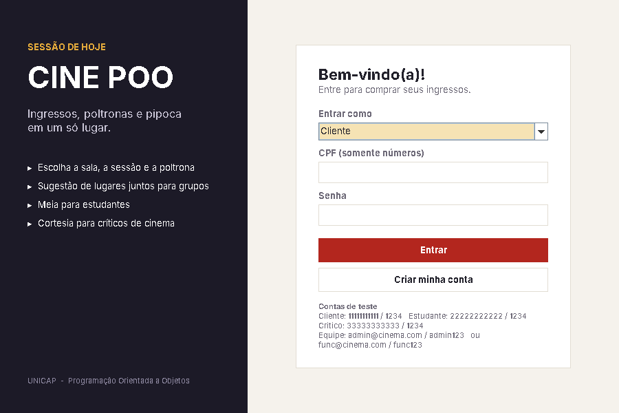
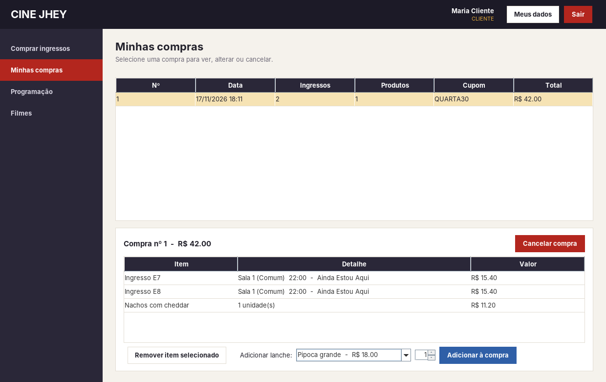
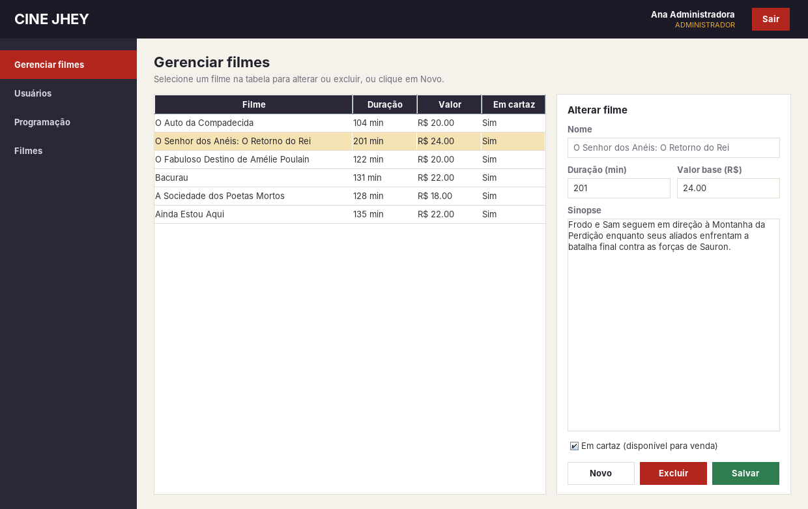

<h1 align="center">🎬 Sistema de Cinema</h1>

<p align="center">
  
  
  
  
  
  
  
</p>

> **Status do Projeto:** :heavy_check_mark: concluído — as quatro etapas foram implementadas

<p align="center">
  
</p>

---

# Tópicos

:small_blue_diamond: [Contexto](#contexto-information_source)

:small_blue_diamond: [Objetivo](#objetivo-dart)

:small_blue_diamond: [Documentos de Orientação](#documentos-de-orientação-book)

:small_blue_diamond: [Funcionalidades](#funcionalidades-video_game)

:small_blue_diamond: [Telas do Sistema](#telas-do-sistema-desktop_computer)

:small_blue_diamond: [Arquitetura](#arquitetura-building_construction)

:small_blue_diamond: [Estrutura do Sistema](#estrutura-do-sistema-classical_building)

:small_blue_diamond: [Tipos de Usuário](#tipos-de-usuário-busts_in_silhouette)

:small_blue_diamond: [Salas e Sessões](#salas-e-sessões-film_projector)

:small_blue_diamond: [Validação e Exceções](#validação-e-exceções-rotating_light)

:small_blue_diamond: [Persistência de Dados](#persistência-de-dados-floppy_disk)

:small_blue_diamond: [Conceitos de POO](#conceitos-de-poo-books)

:small_blue_diamond: [Etapas do Projeto](#etapas-do-projeto-clipboard)

:small_blue_diamond: [Estrutura do Projeto](#estrutura-do-projeto-file_folder)

:small_blue_diamond: [Pré-requisitos](#pré-requisitos-warning)

:small_blue_diamond: [Instalação](#instalação-rocket)

:small_blue_diamond: [Como Rodar o Projeto](#como-rodar-o-projeto-computer)

:small_blue_diamond: [Contas de Teste](#contas-de-teste-key)

:small_blue_diamond: [Tecnologias Utilizadas](#tecnologias-utilizadas-wrench)

:small_blue_diamond: [Desenvolvedoras](#desenvolvedoras-octocat)

:small_blue_diamond: [Informações Acadêmicas](#informações-acadêmicas-mortar_board)

:small_blue_diamond: [Status do Projeto](#status-do-projeto-construction)

:small_blue_diamond: [Licença](#licença)

---

# Contexto :information_source:

<p align="justify">

O <strong>Sistema de Cinema</strong> é um projeto desenvolvido para a disciplina de <strong>Programação Orientada a Objetos</strong>, do 3º período do curso de Ciência da Computação da Universidade Católica de Pernambuco (UNICAP), durante o semestre 2026.2.

</p>

<p align="justify">

O projeto consiste na implementação de um sistema de cinema em Java, envolvendo usuários, filmes, salas, sessões, bilhetes e compras. Durante seu desenvolvimento foram aplicados, de forma prática, os conceitos estudados na disciplina de Programação Orientada a Objetos.

</p>

<p align="justify">

O desenvolvimento foi realizado de forma incremental, em quatro etapas. A cada etapa a estrutura foi ampliada com os novos conceitos apresentados em aula, até chegar à versão final: uma aplicação com interface gráfica em <strong>Java Swing</strong>, arquitetura em camadas <strong>MVC</strong> com o padrão de projeto <strong>Fachada</strong>, validação com <strong>exceções</strong> e persistência dos dados em <strong>arquivos JSON</strong>, sem banco de dados.

</p>

---

# Objetivo :dart:

<p align="justify">

O objetivo do projeto é desenvolver um sistema capaz de representar algumas das principais operações de um cinema, permitindo trabalhar com usuários, filmes, salas, sessões, escolha de cadeiras, bilhetes e compras.

</p>

<p align="justify">

O usuário pode consultar as sessões disponíveis, escolher a sala e a sessão, selecionar uma ou mais cadeiras e realizar a compra de bilhetes. Também é possível incluir produtos da lanchonete, aplicar cupons promocionais e, depois, alterar ou cancelar a compra.

</p>

<p align="justify">

Além das funcionalidades do sistema, o projeto aplica conceitos de Programação Orientada a Objetos como encapsulamento, associação entre objetos, herança, sobrescrita, sobrecarga, enumerações, interfaces, classes abstratas, exceções e padrões de projeto.

</p>

---

# Documentos de Orientação :book:

<p align="justify">

O projeto foi desenvolvido de forma <strong>incremental</strong>, seguindo as etapas e orientações disponibilizadas pelo professor ao longo da disciplina de Programação Orientada a Objetos.

</p>

<p align="justify">

Os documentos utilizados como base para o desenvolvimento estão disponíveis na pasta <code>doc</code> do repositório.

</p>

### 📄 Parte 01 — Classes e Encapsulamento

Definição da estrutura inicial do sistema de cinema, suas classes e relacionamentos.

🔗 [Apresentação de projeto - Parte 1](doc/apresentacao_de_projeto_parte1.pdf)

### 📄 Parte 02 — Herança, Sobrescrita e Sobrecarga

Evolução da estrutura com herança (`Estudante` e `Critico`), sobrescrita, sobrecarga, enumerações e críticas de filmes.

🔗 [Apresentação de projeto - Parte 2](doc/apresentacao_de_projeto_parte2.pdf)

### 📄 Parte 03 — Classes Abstratas e Exceções

Criação da exceção `VendasException`, da classe abstrata `Base`, das classes `Funcionario` e `Administrador`, da interface de gerência de filmes e da persistência dos dados.

🔗 [Apresentação de projeto - Parte 3](doc/apresentacao_de_projeto_parte3.pdf)

### 📄 Parte 04 — Padrões de Projeto

Aplicação de um padrão de projeto com justificativa e preparação da apresentação final.

🔗 [Apresentação de projeto - Parte 4](doc/apresentacao_de_projeto_parte4.pdf)


📁 [Acessar todos os documentos do projeto](https://github.com/the-compilers-organization/cinema/tree/main/doc)

---

# Funcionalidades :video_game:

### Funcionalidades para o cliente

O sistema permite:

- criar uma conta (cliente, estudante ou crítico) e alterar os próprios dados;
- consultar os filmes, com sinopse, nota média e críticas;
- consultar a programação de cada sala;
- escolher a sala e depois a sessão;
- visualizar o mapa de cadeiras da sessão (livres, ocupadas e selecionadas);
- escolher uma cadeira livre para a compra de um bilhete;
- comprar vários bilhetes, com **sugestão de cadeiras lado a lado** para o grupo;
- adicionar produtos da lanchonete à compra;
- aplicar um cupom promocional;
- **realizar** uma compra;
- **alterar** uma compra (remover um ingresso ou produto, adicionar produtos);
- **cancelar** uma compra (as cadeiras voltam a ficar livres);
- avaliar filmes com nota e crítica (somente o crítico).

### Funcionalidades para a equipe do cinema

- incluir, alterar e excluir filmes (administrador e funcionário);
- marcar um filme como "em cartaz" ou "fora de cartaz";
- consultar e alterar os dados dos usuários (administrador e funcionário);
- excluir usuários (somente o administrador).

### Itens da lanchonete

Além dos bilhetes, uma compra pode conter os produtos da enumeração `Produtos`:

| Produto | Valor |
| :--- | :---: |
| Pipoca grande | R$ 18,00 |
| Refrigerante 500ml | R$ 9,00 |
| Chocolate | R$ 7,50 |
| Água mineral | R$ 5,00 |
| Nachos com cheddar | R$ 16,00 |
| Bala de goma | R$ 4,00 |

Não é feito controle de estoque: o projeto considera que o estoque dos produtos é infinito.

### Cupons promocionais

| Cupom | Desconto |
| :--- | :---: |
| `BEMVINDO10` | 10% |
| `CINEPOO20` | 20% |
| `QUARTA30` | 30% |

---

# Telas do Sistema :desktop_computer:

A interface gráfica foi feita com **Java Swing**.

| Login | Comprar ingressos |
| :---: | :---: |
|  |  |

| Minhas compras | Gerenciar filmes (equipe) |
| :---: | :---: |
|  |  |

Telas disponíveis para cada perfil:

| Perfil | Telas |
| :--- | :--- |
| Cliente / Estudante | Comprar ingressos, Minhas compras, Programação, Filmes |
| Crítico | as mesmas do cliente + Avaliar filmes |
| Administrador / Funcionário | Gerenciar filmes, Usuários, Programação, Filmes |

---

# Arquitetura :building_construction:

O projeto segue a **arquitetura em 3 camadas** vista em aula, com **MVC** e o padrão de projeto **Fachada**.

```text
 UI (view)          LoginView, CompraView, FilmesView ...  (telas Swing)
                                     │
                                     ○  IFachada
                                     │
 NEGÓCIO (controller)             Fachada
                 ┌──────────────┬────┴─────────┬───────────────┐
         UsuarioController  FilmeController  SessaoController  CompraController
                 │   usam as entidades do model: Usuario, Filme, Sala, Sessao, Compra ...
                 │
                 ○  IRepositorioUsuario   ○  IRepositorioFilme   ○  IRepositorioCompra
                 │
 DADOS (repository)  RepositorioUsuarioJSON   RepositorioFilmeJSON   RepositorioCompraJSON  →  data/*.json
```

| Camada | Pacote | Responsabilidade | Comunica-se com a camada de baixo por |
| :--- | :--- | :--- | :--- |
| **UI** | `view` | Telas Swing. Cada tela trata os próprios cliques e mostra as mensagens de erro. | interface `IFachada` |
| **Negócio** | `controller` e `model` | `Fachada`, controllers e entidades, com as regras de negócio e as validações. | interfaces `IRepositorioUsuario`, `IRepositorioFilme` e `IRepositorioCompra` |
| **Dados** | `repository` | Leitura e gravação dos arquivos JSON. | arquivos da pasta `data/` |

Leitura MVC do projeto:

- **Model** → pacote `model` (entidades: `Usuario`, `Filme`, `Sala`, `Sessao`, `Bilhete`, `Compra`...);
- **View** → pacote `view` (telas);
- **Controller** → pacote `controller` (`UsuarioController`, `FilmeController`, `SessaoController`, `CompraController`), acessados pela `Fachada`.

### Padrão de projeto: Fachada (Parte 4)

<p align="justify">

<strong>Justificativa:</strong> uma operação como "comprar ingresso" envolve várias classes (<code>Usuario</code>, <code>Sala</code>, <code>Sessao</code>, <code>Bilhete</code>, <code>Compra</code>, controllers e repositórios). Sem a fachada, cada tela precisaria conhecer e coordenar todas elas. A classe <code>Fachada</code>, que implementa a interface <code>IFachada</code>, é o <strong>único ponto de entrada</strong> da camada de negócio: recebe o pedido da tela e repassa para o controller responsável. Quando uma operação envolve mais de um controller, é a fachada que coordena. Por exemplo, antes de excluir um usuário ela consulta o <code>CompraController</code> para saber se ele tem compras.

</p>

```java
// Main.java - a tela recebe a fachada pelo tipo da INTERFACE
IFachada fachada = new Fachada();

// Fachada.java - repassa o pedido para o controller
public void finalizarCompra(Compra compra) throws CompraException, VendasException, PersistenciaException {
    compraController.finalizar(compra);
}

// Fachada.java - os repositórios também são usados pelo tipo da interface
IRepositorioUsuario repositorioUsuario = new RepositorioUsuarioJSON();
```

Regras de dependência entre as camadas:

- as telas **nunca** acessam controllers, repositórios ou arquivos diretamente: só chamam métodos da `IFachada`;
- os controllers **não sabem** que os dados estão em JSON: usam apenas as interfaces `IRepositorio...`. Para trocar JSON por banco de dados, bastaria criar uma nova classe que implemente a interface e mudar uma linha no construtor da `Fachada`.

---

# Estrutura do Sistema :classical_building:

As classes principais do sistema estão no pacote `model`:

| Classe | Responsabilidade |
| :--- | :--- |
| `Usuario` | Usuário que compra os bilhetes online. |
| `Estudante` | Herda de `Usuario` e paga meia-entrada. |
| `Critico` | Herda de `Usuario`, tem o atributo `origem`, não paga o bilhete e avalia filmes. |
| `Filme` | Filme exibido pelo cinema, com nota média e vetor de críticas. |
| `Critica` | Crítica feita por um crítico (nome, origem e mensagem). |
| `Sala` | Sala do cinema, com o tipo de sala e o vetor de sessões (grade de horários). |
| `Sessao` | Sessão de uma sala, com o filme e a matriz de cadeiras. |
| `Cadeira` | Cadeira da matriz de uma sessão (livre ou ocupada). |
| `Bilhete` | Bilhete comprado pelo usuário. |
| `Compra` | Compra com um ou mais bilhetes e produtos da lanchonete. |
| `ItemCompra` | Produto da lanchonete dentro de uma compra (produto, quantidade e subtotal). |
| `Base` | Classe abstrata com nome, idade e e-mail da equipe do cinema. |
| `Funcionario` | Herda de `Base`, gerencia filmes e cadastra/altera usuários. |
| `Administrador` | Herda de `Base`, gerencia filmes e usuários, exclui usuários e cuida da persistência. |
| `Validador` | Métodos de validação reaproveitados pelas classes do modelo. |

Por padrão, as classes possuem:

- atributos `private`;
- métodos `public`;
- construtores;
- getters;
- setters com validação (lançam `ValidacaoException` quando o dado é inválido).

---

## 👤 Usuario

A classe `Usuario` representa a pessoa responsável pela compra dos bilhetes online.

Entre suas informações estão:

- usuário;
- CPF (11 números);
- senha (mínimo de 4 caracteres);
- idade;
- sexo;
- e-mail;
- nome do cartão;
- número do cartão (16 números);
- código verificador do cartão (3 números).

O nome de usuário e o nome do cartão aceitam **somente letras e espaços**.

O usuário pode:

- realizar uma compra;
- alterar uma compra;
- cancelar uma compra.

O método `comprarBilhete` fica na classe `Usuario` e é **sobrescrito** pelas subclasses:

| Classe | Valor do bilhete |
| :--- | :--- |
| `Usuario` | valor do filme × multiplicador da sala |
| `Estudante` | metade do valor |
| `Critico` | sempre zero |

O método também é **sobrecarregado** com um parâmetro a mais do tipo `CupomPromocional`, que aplica o desconto do cupom.

---

## 🎬 Filme

A classe `Filme` representa o filme exibido em uma sessão.

Possui:

- nome;
- duração;
- sinopse;
- valor;
- em cartaz (sim/não);
- nota (média das notas dos críticos);
- quantidade de críticos;
- vetor de críticas com tamanho máximo de **100**.

O crítico usa os métodos:

- `atribuirNota(double nota, Filme filme)`: recebe uma nota de 0 a 10, incrementa a quantidade de críticos e calcula a nova média;
- `atribuirCritica(String critica, Filme filme)`: coloca a crítica no final do vetor de críticas do filme.

---

## 🎟️ Bilhete

A classe `Bilhete` representa o ingresso adquirido pelo usuário.

O bilhete contém informações relacionadas a:

- usuário;
- CPF;
- sala (número e tipo);
- sessão (horário);
- filme;
- valor;
- cadeira comprada (linha e coluna).

O valor do bilhete é calculado com base no filme e na sala escolhidos: **valor do filme × multiplicador da sala**.

---

## 🏢 Sala

A classe `Sala` representa uma sala do cinema e possui um **tipo de sala** (enumeração `TipoSala`):

| Tipo | Multiplicador |
| :--- | :---: |
| Comum | 1.0 |
| 3D | 1.2 |
| XD | 1.3 |
| XD/3D | 1.4 |

Cada sala possui um vetor de sessões de **tamanho fixo**, organizado de acordo com uma grade de horários.

Quando não existe sessão em determinado horário, aquela posição fica como `null` e não aparece para o usuário.

---

## 🕐 Sessao

A classe `Sessao` representa uma sessão disponível em uma sala do cinema.

Cada sessão contém:

- o horário;
- o filme exibido;
- uma matriz de cadeiras de **10 linhas × 15 colunas**.

A sessão permite verificar quais cadeiras estão disponíveis, ocupar e liberar cadeiras, verificar se o horário da sessão já passou e procurar cadeiras livres lado a lado.

---

## 🛒 Compra

A classe `Compra` representa as compras realizadas pelo usuário.

Uma compra possui:

- **um ou mais bilhetes** (não é possível finalizar uma compra sem bilhete);
- produtos da lanchonete;
- cupom promocional (opcional).

O método de compra de bilhetes é implementado separadamente do método de compra de produtos.

O método `comprarProduto` é **sobrecarregado** com um parâmetro a mais do tipo `CupomPromocional`.

Regras da escolha de cadeiras:

- ao comprar apenas **um** bilhete, o usuário escolhe uma cadeira livre no mapa;
- ao comprar **vários** bilhetes, o sistema **sugere cadeiras lado a lado** na mesma fileira, começando pelas fileiras do meio da sala;
- a quantidade de cadeiras selecionadas precisa ser igual à quantidade de pessoas informada em "Quantas pessoas?".

---

# Tipos de Usuário :busts_in_silhouette:

### Clientes (compram ingressos)

| Tipo | Classe | Particularidade |
| :--- | :--- | :--- |
| Cliente | `Usuario` | paga o valor do filme × multiplicador da sala |
| Estudante | `Estudante` | paga metade do valor |
| Crítico | `Critico` | não paga o bilhete, tem o atributo `origem` e pode avaliar filmes |

Os três podem realizar, alterar e cancelar compras.

### Equipe do cinema

As classes da equipe herdam da classe abstrata `Base` (nome, idade e e-mail), que define os métodos abstratos `adicionarUsuario` e `alterarUsuario`. As duas implementam a interface `GerenciaFilmes` (incluir, excluir e alterar filmes).

| Tipo | Classe | Atributos | O que pode fazer |
| :--- | :--- | :--- | :--- |
| Funcionário | `Funcionario` | salário | gerenciar filmes, cadastrar e alterar usuários |
| Administrador | `Administrador` | salário e ID | o mesmo do funcionário + **excluir usuários** + cuidar da **persistência** dos dados de usuários e filmes |

---

# Salas e Sessões :film_projector:

O cinema possui 4 salas, uma de cada tipo, e cada sala possui uma grade de 7 horários.

Uma sessão relaciona:

```text
Sala
  │
  └── Sessao
        │
        ├── Filme
        │
        └── Cadeiras (matriz 10 x 15)
```

### Exemplo de grade de sessões (Sala 1 - Comum)

| Horário | Filme |
| :---: | :--- |
| 10:00 | O Auto da Compadecida |
| 12:00 | O Senhor dos Anéis: O Retorno do Rei |
| 14:00 | O Fabuloso Destino de Amélie Poulain |
| 16:00 | *(sem sessão: posição `null`, não aparece para o usuário)* |
| 18:00 | Bacurau |
| 20:00 | A Sociedade dos Poetas Mortos |
| 22:00 | Ainda Estou Aqui |

A programação é montada ao iniciar o sistema, com os filmes que estão **em cartaz**.

### 💺 Cadeiras

As cadeiras de uma sessão são implementadas com uma matriz de tamanho fixo de **10 linhas** (A a J) e **15 colunas** (1 a 15).

Na tela, o mapa de cadeiras usa as cores:

```text
                 TELA

       1  2  3  4  5  6  7  8 ... 15

A      O  O  O  O  O  O  O  O ... O
B      O  O  X  X  O  O  O  O ... O
C      O  O  O  O  O  O  O  O ... O
...

O = cadeira livre        X = cadeira ocupada
Amarelo = selecionada    Azul = já está no carrinho
```

---

# Validação e Exceções :rotating_light:

Seguindo a aula de exceções, as exceções do sistema **estendem `Exception`**, são **declaradas com `throws`**, **lançadas com `throw`** nas camadas de negócio e de dados e **tratadas com `try/catch`** nas telas, que mostram a mensagem para o usuário. Na leitura e gravação dos arquivos, o bloco **`finally`** garante que o arquivo seja sempre fechado.

| Exceção | Quando acontece |
| :--- | :--- |
| `VendasException` | **(Parte 3)** compra de bilhete de sessão que **já começou**, de **poltrona já selecionada** ou de filme **fora de cartaz** |
| `ValidacaoException` | dado inválido: campo vazio, nome de usuário ou nome do cartão com números, CPF sem 11 dígitos, e-mail inválido, nota fora de 0–10, quantidade de cadeiras diferente da quantidade de pessoas etc. |
| `UsuarioException` | CPF já cadastrado, login incorreto, funcionário tentando excluir usuário, exclusão de usuário com compras |
| `FilmeException` | filme duplicado, filme não encontrado ou exclusão de filme que está na programação |
| `CompraException` | finalizar compra sem ingresso ou remover o último ingresso de uma compra |
| `PersistenciaException` | erro ao ler ou gravar os arquivos JSON |

O sistema também trata a `NumberFormatException` do Java quando o usuário digita letras em campos numéricos (idade, duração, valor).

A validação fica nos **setters e construtores** do modelo. Exemplo:

```java
public void setCpf(String cpf) throws ValidacaoException {
    String cpfLimpo = Validador.limparCpf(cpf);
    Validador.somenteDigitos(cpfLimpo, 11, "CPF");
    this.cpf = cpfLimpo;
}
```

E o tratamento acontece na tela:

```java
try {
    fachada.adicionarIngressos(carrinho, usuario, sala, sessao, cadeiras, quantidadePessoas, cupom);
} catch (VendasException e) {
    Mensagens.erro(this, "Venda não permitida - " + e.getMotivo(), e.getMessage());
} catch (ValidacaoException e) {
    Mensagens.aviso(this, e.getMessage());
}
```

---

# Persistência de Dados :floppy_disk:

<p align="justify">

O sistema <strong>não usa banco de dados</strong>. Os dados são gravados em arquivos <strong>JSON</strong> na pasta <code>data/</code>, usando a biblioteca <strong>Gson</strong>. Como pede a Parte 3, o <strong>Administrador</strong> é o responsável pela persistência dos dados de usuários e filmes, e faz isso pelas interfaces <code>IRepositorioUsuario</code> e <code>IRepositorioFilme</code>.

</p>

| Arquivo | Conteúdo | Repositório |
| :--- | :--- | :--- |
| `data/usuarios.json` | clientes, estudantes e críticos | `RepositorioUsuarioJSON` |
| `data/filmes.json` | filmes, notas e críticas | `RepositorioFilmeJSON` |
| `data/compras.json` | compras, bilhetes e produtos | `RepositorioCompraJSON` |

Para voltar aos dados iniciais, basta restaurar os arquivos da pasta `data/` (ou deixar `compras.json` com `[]`).

> Por ser um projeto acadêmico, a senha e os dados do cartão ficam em texto no JSON. Em um sistema real eles seriam criptografados.

---

# Conceitos de POO :books:

| Conceito | Onde foi aplicado |
| :--- | :--- |
| Classes, objetos, atributos e métodos | todas as classes do pacote `model` |
| Encapsulamento e modificadores de acesso | atributos `private`, métodos `public`, getters e setters |
| Construtores | todas as entidades (com validação dos dados) |
| Associação entre objetos | `Sala` → `Sessao` → `Filme` e `Cadeira`; `Compra` → `Bilhete` e `ItemCompra` |
| Vetores e vetores de objetos | `Sessao[]` em `Sala`; `Critica[100]` em `Filme` |
| Matrizes | `Cadeira[10][15]` em `Sessao` |
| Herança | `Estudante` e `Critico` herdam de `Usuario`; `Funcionario` e `Administrador` herdam de `Base` |
| Sobrescrita | `comprarBilhete` em `Estudante` e `Critico`; `getTipo`; `copiarDados` em `Critico` |
| Sobrecarga | `comprarBilhete(..., cupom)` e `comprarProduto(..., cupom)` |
| Enumerações | `Produtos`, `CupomPromocional`, `TipoSala`, `Sexo` |
| Interfaces | `GerenciaFilmes`, `IFachada`, `IRepositorioUsuario`, `IRepositorioFilme`, `IRepositorioCompra`, `Atualizavel` |
| Classes abstratas | `Base` |
| Polimorfismo | `Base` (administrador ou funcionário) e `GerenciaFilmes` usados pelo tipo da classe-mãe ou da interface |
| Exceções | `VendasException`, `ValidacaoException`, `UsuarioException`, `FilmeException`, `CompraException`, `PersistenciaException` |
| Padrões de projeto | Fachada (`IFachada` + `Fachada`) e arquitetura em camadas (MVC) |

---

# Etapas do Projeto :clipboard:

O projeto foi desenvolvido de forma incremental.

### Etapa 01 — Classes e Encapsulamento

✅ **Concluída**

Criação da estrutura inicial do sistema: `Usuario`, `Sala`, `Sessao`, `Filme`, `Bilhete` e `Compra`, com atributos privados, construtores, getters, setters e relacionamento entre os objetos. Inclui a escolha de cadeiras e a sugestão de cadeiras juntas.

### Etapa 02 — Herança, Sobrescrita e Sobrecarga

✅ **Concluída**

Enumerações `Produtos`, `CupomPromocional` e `TipoSala`; classes `Estudante` e `Critico` com sobrescrita da compra de bilhetes; sobrecarga das compras com cupom; classe `Critica`, nota média e vetor de críticas em `Filme`.

### Etapa 03 — Classes Abstratas e Exceções

✅ **Concluída**

`VendasException` com os três erros de venda; classe abstrata `Base`; classes `Funcionario` e `Administrador`; interface `GerenciaFilmes`; persistência dos dados de usuários e filmes feita pelo administrador.

### Etapa 04 — Padrões de Projeto

✅ **Concluída**

Aplicação do padrão de projeto **Fachada** com justificativa, arquitetura em 3 camadas (UI, negócio e dados) e interface gráfica em Java Swing.

---

# Estrutura do Projeto :file_folder:

```text
cinema/
│
├── data/                              arquivos JSON (persistência)
│   ├── usuarios.json
│   ├── filmes.json
│   └── compras.json
│
├── doc/
│   ├── apresentacao_de_projeto_parte1.pdf
│   ├── apresentacao_de_projeto_parte2.pdf
│   ├── apresentacao_de_projeto_parte3.pdf
│   ├── apresentacao_de_projeto_parte4.pdf
│   └── telas/                         imagens das telas
│
├── src/
│   ├── Main.java                      cria a Fachada e abre a tela de login
│   │
│   ├── view/                          CAMADA UI - telas Swing
│   │   ├── LoginView.java
│   │   ├── PrincipalView.java
│   │   ├── CadastroUsuarioView.java
│   │   ├── CompraView.java
│   │   ├── MapaCadeirasPanel.java
│   │   ├── MinhasComprasView.java
│   │   ├── ProgramacaoView.java
│   │   ├── FilmesView.java
│   │   ├── CriticaView.java
│   │   ├── GerenciarFilmesView.java
│   │   ├── GerenciarUsuariosView.java
│   │   ├── Atualizavel.java
│   │   ├── Estilo.java
│   │   └── Mensagens.java
│   │
│   ├── controller/                    CAMADA DE NEGÓCIO
│   │   ├── IFachada.java
│   │   ├── Fachada.java
│   │   ├── UsuarioController.java
│   │   ├── FilmeController.java
│   │   ├── SessaoController.java
│   │   └── CompraController.java
│   │
│   ├── model/                         CAMADA DE NEGÓCIO - entidades
│   │   ├── Usuario.java, Estudante.java, Critico.java
│   │   ├── Base.java, Funcionario.java, Administrador.java
│   │   ├── Filme.java, Critica.java
│   │   ├── Sala.java, Sessao.java, Cadeira.java
│   │   ├── Bilhete.java, Compra.java, ItemCompra.java
│   │   ├── Validador.java
│   │   ├── enums/                     Produtos, CupomPromocional, TipoSala, Sexo
│   │   └── interfaces/                GerenciaFilmes
│   │
│   ├── repository/                    CAMADA DE DADOS
│   │   ├── IRepositorioUsuario.java,  RepositorioUsuarioJSON.java
│   │   ├── IRepositorioFilme.java,    RepositorioFilmeJSON.java
│   │   ├── IRepositorioCompra.java,   RepositorioCompraJSON.java
│   │   └── ArquivoJson.java
│   │
│   └── exceptions/                    exceções usadas pelas camadas
│       ├── VendasException.java
│       ├── ValidacaoException.java
│       ├── UsuarioException.java
│       ├── FilmeException.java
│       ├── CompraException.java
│       └── PersistenciaException.java
│
├── pom.xml
├── README.md
└── LICENSE
```

---

# Pré-requisitos :warning:

Antes de clonar e executar o projeto, é necessário ter instalado:

### 1. Java

- JDK **17 ou superior** instalado e configurado no computador.

### 2. Maven

- Maven instalado e configurado no computador. Ele baixa automaticamente a biblioteca **Gson**, usada para ler e gravar os arquivos JSON.

### 3. Git

- Necessário para clonar e trabalhar com o repositório.

### 4. IDE ou editor de código

O projeto pode compilado e executado em:

- VS Code (com o Extension Pack for Java);
- IntelliJ IDEA;
- Eclipse;
- NetBeans.

> :warning:A IDE deve utilizar o JDK configurado para o projeto e reconhecer as dependências declaradas no arquivo pom.xml.

---

# Instalação :rocket:

### 1️⃣ Clonar o repositório

```bash
git clone https://github.com/the-compilers-organization/cinema.git
```

### 2️⃣ Entrar na pasta do projeto

```bash
cd cinema
```

---

# Como Rodar o Projeto :computer:

Compile o projeto:

```bash
mvn clean compile
```

Execute a classe principal:

```bash
mvn exec:java
```

> :warning: Rode sempre a partir da **pasta raiz do projeto** (onde está o `pom.xml`), pois os arquivos de dados ficam na pasta `data/`.

Na IDE, basta abrir a pasta como projeto Maven e executar a classe `Main`.

---

# Contas de Teste :key:

Na tela de login, escolha o perfil em **"Entrar como"**:

| Perfil | Login | Senha |
| :--- | :--- | :--- |
| Cliente | `11111111111` | `1234` |
| Estudante (paga meia) | `22222222222` | `1234` |
| Crítico (não paga e avalia filmes) | `33333333333` | `1234` |
| Administrador | `admin@cinema.com` | `admin123` |
| Funcionário | `func@cinema.com` | `func123` |

Também é possível criar uma nova conta pelo botão **"Criar minha conta"**.

> A verificação de "sessão que já começou" compara o horário da sessão com o relógio do computador. Se o sistema for testado à noite, as sessões da tarde aparecerão como "Já começou", que é o comportamento pedido na Parte 3.

---

# Tecnologias Utilizadas :wrench:

- **Java 17**
- **Java Swing** (interface gráfica): Biblioteca utilizada para criar a interface gráfica, incluindo telas, botões, formulários e o mapa de cadeiras.
- **Gson** (leitura e gravação de JSON): Biblioteca utilizada para ler e gravar os dados de usuários, filmes e compras em arquivos JSON.
- **Maven**: Ferramenta utilizada para gerenciar as dependências do projeto, como o Gson, e automatizar a compilação e execução.
- **Programação Orientada a Objetos**
- **Git**
- **GitHub**

---

# Desenvolvedoras :octocat:

Time responsável pelo desenvolvimento do projeto.

| [<br><sub>Amanda Aziz</sub>](https://github.com/Amanda-Aziz) | [<br><sub>Francis Lauriano</sub>](https://github.com/francisLauriano) | [<br><sub>Sofia Farias</sub>](https://github.com/Sofiafs) |
| :---: | :---: | :---: |

---

# Informações Acadêmicas :mortar_board:

**Universidade:** Universidade Católica de Pernambuco - UNICAP  
**Curso:** Ciência da Computação  
**Disciplina:** Programação Orientada a Objetos  
**Período:** 3º período  
**Semestre:** 2026.2  
**Docente:** Jheymesson A. Cavalcanti  

### Discentes

| Discente | RA |
| :--- | :---: |
| Amanda Aziz | 00000859509 |
| Francis Lauriano | 00000860720 |
| Sofia Farias | 00000860528 |

---

# Status do Projeto :construction:

✅ **Concluído**

As quatro etapas definidas pelo professor foram implementadas.

| Etapa | Status |
| :--- | :---: |
| Classes e Encapsulamento | ✅ Concluída |
| Herança, Sobrescrita e Sobrecarga | ✅ Concluída |
| Classes Abstratas e Exceções | ✅ Concluída |
| Padrões de Projeto | ✅ Concluída |

### Legenda

- ✅ Concluído
- ⚠️ Em desenvolvimento
- ❌ Não iniciada

---

# Licença

The [MIT License](LICENSE) (MIT)

Copyright © 2026 - Sistema de Cinema
