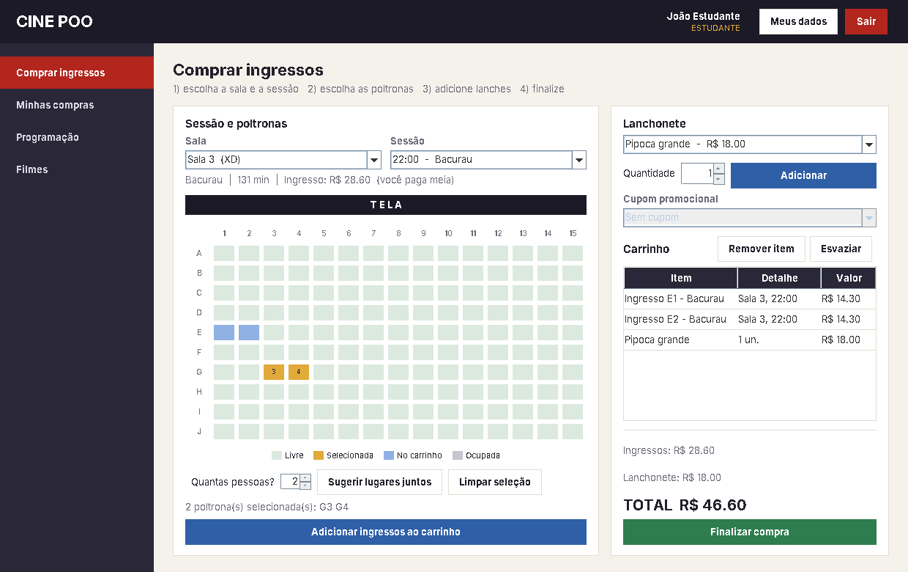

<h1 align="center">🎬 Sistema de Cinema — Cine POO</h1>

<p align="center">
  
  
  
  
</p>

Projeto da disciplina de **Programação Orientada a Objetos** (3º período de Ciência da Computação, UNICAP, 2026.2).
Sistema de cinema em Java com interface gráfica **Swing**, arquitetura em camadas **MVC**, padrão de projeto **Fachada**,
**validação com exceções** e persistência em **arquivos JSON** (sem banco de dados).



---

## Como rodar

Pré-requisitos: **JDK 17 ou superior** e **Maven**.

```bash
mvn clean compile
mvn exec:java
```

> Rode sempre a partir da **pasta raiz do projeto** (onde está o `pom.xml`), pois os dados ficam em `data/`.
> No VS Code/IntelliJ basta abrir a pasta como projeto Maven e executar a classe `Main`.

### Contas de teste

| Perfil | Login | Senha |
| :--- | :--- | :--- |
| Cliente | `11111111111` | `1234` |
| Estudante (paga meia) | `22222222222` | `1234` |
| Crítico (não paga e avalia filmes) | `33333333333` | `1234` |
| Administrador | `admin@cinema.com` | `admin123` |
| Funcionário | `func@cinema.com` | `func123` |

Na tela de login escolha **Cliente** ou **Equipe do cinema** em "Entrar como".

---

## Arquitetura em 3 camadas (MVC + Fachada)

O projeto segue o padrão de **arquitetura em 3 camadas** visto em aula
(UI → `IFachada` → `Fachada` → `XxxController` → `IRepositorio` → Repositórios):

```text
 UI          LoginView, CompraView, FilmesView ...   (telas Swing - classes de fronteira)
                              │
                              ○  IFachada
                              │
 NEGÓCIO                   Fachada
              ┌───────────┬───┴───────┬────────────┐
     UsuarioController  FilmeController  SessaoController  CompraController
              │  usam as entidades: Usuario, Filme, Sala, Sessao, Compra ...
              │
              ○  IRepositorioUsuario   ○  IRepositorioFilme   ○  IRepositorioCompra
              │
 DADOS     RepositorioUsuarioJSON   RepositorioFilmeJSON   RepositorioCompraJSON  →  data/*.json
```

| Camada | Pacote | Classes | Conversa com a camada de baixo por |
| :--- | :--- | :--- | :--- |
| **UI** | `view` | telas Swing; cada tela trata os próprios cliques | interface **`IFachada`** |
| **Negócio** | `controller`, `model` | `IFachada`, `Fachada`, `UsuarioController`, `FilmeController`, `SessaoController`, `CompraController` e as entidades | interfaces **`IRepositorioUsuario`**, **`IRepositorioFilme`**, **`IRepositorioCompra`** |
| **Dados** | `repository` | `RepositorioUsuarioJSON`, `RepositorioFilmeJSON`, `RepositorioCompraJSON`, `ArquivoJson` | arquivos `data/*.json` (biblioteca Gson) |

```text
src/
├── Main.java                  cria a Fachada (IFachada fachada = new Fachada()) e abre o login
├── view/                      UI - telas Swing (LoginView, CompraView...), chamam a IFachada
├── controller/                NEGÓCIO - IFachada, Fachada, UsuarioController, FilmeController,
│                              SessaoController, CompraController
├── model/                     NEGÓCIO - entidades, enums, interface GerenciaFilmes, Validador
├── repository/                DADOS - interfaces IRepositorio... e implementações em JSON
└── exceptions/                exceções usadas por todas as camadas
data/                          usuarios.json, filmes.json, compras.json
```

Leitura MVC do projeto: **Model** = `model/` (entidades), **View** = `view/` (telas),
**Controller** = `controller/` (`UsuarioController`, `FilmeController`, `SessaoController`, `CompraController`),
acessados pela `Fachada`.

Regras de dependência:
- as telas **nunca** acessam controladores, repositórios ou arquivos: só chamam métodos de `IFachada`;
- os controladores **nunca** sabem que os dados estão em JSON: usam apenas as interfaces `IRepositorio...`.
  Para trocar JSON por banco de dados bastaria criar `RepositorioUsuarioBDR implements IRepositorioUsuario`
  e mudar uma linha no construtor da `Fachada`.

### Padrão de projeto escolhido: **Fachada** (Parte 4)

**Justificativa:** uma operação como "comprar ingresso" envolve várias classes (`Usuario`, `Sala`, `Sessao`,
`Bilhete`, `Compra`, controladores e repositórios). Sem a fachada, cada tela precisaria conhecer e coordenar
todas elas. A **`Fachada`** (que implementa a interface **`IFachada`**) é o **único ponto de entrada** da camada
de negócio: recebe o pedido da tela e repassa para o controlador responsável. Quando uma operação envolve mais
de um controlador, é a fachada que coordena — por exemplo, `excluirUsuario` consulta o `CompraController`
(o usuário tem compras?) antes de chamar o `UsuarioController`.

```java
// Main.java - a UI recebe a fachada pelo tipo da INTERFACE
IFachada fachada = new Fachada();

// Fachada.java - repassa para o controlador
public void finalizarCompra(Compra compra) throws CompraException, VendasException, PersistenciaException {
    compraController.finalizar(compra);
}

// Fachada.java (construtor) - os repositórios também são usados pelo tipo da interface
IRepositorioUsuario repositorioUsuario = new RepositorioUsuarioJSON();
```

---

## Validação e exceções

Seguindo a aula 14: as exceções do sistema **estendem `Exception`** (são checadas), são **declaradas com `throws`**,
**lançadas com `throw`** no modelo e **tratadas com `try/catch`** nas telas (`view`), que mostram a mensagem para o usuário.
Em `ArquivoJson` o bloco **`finally`** garante que o arquivo é sempre fechado.

| Exceção | Quando acontece |
| :--- | :--- |
| `VendasException` | **(Parte 3)** os 3 erros de venda: sessão que já começou, poltrona já selecionada, filme fora de cartaz |
| `ValidacaoException` | dado inválido: campo vazio, nome de usuário ou nome no cartão com números, CPF sem 11 dígitos, e-mail inválido, nota fora de 0–10, quantidade de poltronas diferente de "Quantas pessoas?", etc. |
| `UsuarioException` | CPF já cadastrado, login incorreto, funcionário tentando excluir usuário |
| `FilmeException` | filme duplicado, não encontrado, ou excluir filme que está na programação |
| `CompraException` | finalizar compra sem ingresso, remover o último ingresso de uma compra |
| `PersistenciaException` | erro ao ler ou gravar os arquivos JSON |

Também é tratada a `NumberFormatException` (exceção do Java) quando o usuário digita letras na idade, duração ou valor.

A validação fica nos **setters/construtores do modelo** (com ajuda da classe `Validador`). Exemplo:

```java
public void setCpf(String cpf) throws ValidacaoException {
    String cpfLimpo = Validador.limparCpf(cpf);
    Validador.somenteDigitos(cpfLimpo, 11, "CPF");
    this.cpf = cpfLimpo;
}
```

E o tratamento acontece na tela (`CompraView`):

```java
try {
    fachada.adicionarIngressos(carrinho, usuario, sala, sessao, cadeiras, cupom);
} catch (VendasException e) {
    Mensagens.erro(view, "Venda não permitida - " + e.getMotivo(), e.getMessage());
} catch (ValidacaoException e) {
    Mensagens.aviso(view, e.getMessage());
}
```

---

## Onde está cada requisito

### Parte 1 — Classes e encapsulamento
| Requisito | Onde |
| :--- | :--- |
| Atributos `private`, métodos `public`, construtores, getters e setters | todas as classes de `model` |
| `Usuario` (user, CPF, senha, idade, sexo, e-mail, dados do cartão) | `model/Usuario.java` |
| Usuário realiza, altera e cancela compra | telas **Comprar ingressos** e **Minhas compras** → `IFachada.finalizarCompra`, `removerItemDaCompra`, `adicionarProdutoNaCompra`, `cancelarCompra` (executados pelo `CompraController`) |
| `Filme` (nome, duração, sinopse, valor) | `model/Filme.java` |
| `Bilhete` (user, CPF, sala, sessão, filme, valor, cadeira); valor = filme × sala | `model/Bilhete.java` |
| `Compra` com produtos e um ou mais bilhetes | `model/Compra.java` (`CompraException` se não houver bilhete) |
| Método de compra de bilhetes à parte | `Usuario.comprarBilhete(...)` |
| 1 bilhete: escolhe poltrona livre; vários: sistema sugere cadeiras juntas | mapa de poltronas + botão **Sugerir lugares juntos** → `Sessao.buscarCadeirasJuntas` |
| `Sala` com vetor de sessões de tamanho fixo (grade); horário vazio = `null` e não aparece | `model/Sala.java` (`HORARIOS`, `getSessoesDisponiveis`) |
| `Sessao` com matriz de cadeiras 10 × 15 | `model/Sessao.java` |

### Parte 2 — Herança, sobrescrita e sobrecarga
| Requisito | Onde |
| :--- | :--- |
| Enum `Produtos` (nome e valor) integrado à compra | `model/enums/Produtos.java`, `Compra.comprarProduto` |
| Enum `CupomPromocional` com 3 cupons | `model/enums/CupomPromocional.java` |
| Enum de salas (tipo e multiplicador 1.0 / 1.2 / 1.3 / 1.4) | `model/enums/TipoSala.java` |
| Fluxo: escolha da sala → escolha da sessão | tela **Comprar ingressos** |
| `Estudante` sobrescreve a compra de bilhete (metade do valor) | `Estudante.comprarBilhete` |
| `Critico` com `origem`; sobrescreve a compra (valor zero) | `Critico.comprarBilhete` |
| `Filme` com `nota` e `quantidadeCriticos` | `model/Filme.java` |
| Sobrecarga das compras com `CupomPromocional` | `Usuario.comprarBilhete(..., cupom)` e `Compra.comprarProduto(..., cupom)` |
| Classe `Critica` (nome, origem, mensagem); vetor de 100 críticas em `Filme` | `model/Critica.java`, `Filme.criticas` |
| `atribuirNota` (0 a 10, incrementa críticos, recalcula média) e `atribuirCritica` (fim do vetor) | `model/Critico.java`, tela **Avaliar filmes** |

### Parte 3 — Classes abstratas e exceções
| Requisito | Onde |
| :--- | :--- |
| `VendasException` com os 3 erros | `exceptions/VendasException.java`, lançada em `Usuario.comprarBilhete` |
| Classe abstrata `Base` (nome, idade, e-mail; abstratos adicionar/alterar usuário) | `model/Base.java` |
| `Funcionario` (salário; implementa Base e GerenciaFilmes) | `model/Funcionario.java` |
| `Administrador` (salário e ID; excluir usuário; GerenciaFilmes) | `model/Administrador.java` |
| Interface de gerência de filmes (incluir, excluir, alterar) | `model/interfaces/GerenciaFilmes.java`, tela **Gerenciar filmes** |
| Administrador responsável pela persistência de usuários e filmes | `Administrador` grava pelas interfaces `IRepositorioUsuario` e `IRepositorioFilme`. O `Funcionario` repassa as operações para ele |

### Parte 4 — Padrão de projeto
| Requisito | Onde |
| :--- | :--- |
| Padrão aplicado com justificativa | **Fachada** — `controller/IFachada.java` + `controller/Fachada.java` (ver seção acima) |

---

## Observações

- A situação "sessão que já começou" compara o horário da sessão com o **relógio do computador**. Se você testar à noite,
  as sessões da tarde aparecerão como "Já começou" na Programação — é o comportamento pedido na Parte 3.
- A programação do dia é montada ao iniciar o sistema com os filmes **em cartaz**. Filmes novos entram na programação
  na próxima execução. Para tirar um filme das vendas, desmarque **Em cartaz** (filmes da programação não podem ser excluídos).
- Para voltar aos dados iniciais, restaure os arquivos da pasta `data/` (ou deixe `compras.json` com `[]`).
- Por ser um projeto acadêmico, senha e dados do cartão ficam em texto no JSON. Em um sistema real eles seriam criptografados.

---

## Desenvolvedoras

| [<br><sub>Amanda Aziz</sub>](https://github.com/Amanda-Aziz) | [<br><sub>Francis Lauriano</sub>](https://github.com/francisLauriano) | [<br><sub>Sofia Farias</sub>](https://github.com/Sofiafs) |
| :---: | :---: | :---: |

**Universidade:** Universidade Católica de Pernambuco - UNICAP  
**Curso:** Ciência da Computação — 3º período — 2026.2  
**Disciplina:** Programação Orientada a Objetos  
**Docente:** Jheymesson A. Cavalcanti

| Discente | RA |
| :--- | :---: |
| Amanda Aziz | 00000859509 |
| Francis Lauriano | 00000860720 |
| Sofia Farias | 00000860528 |

## Licença

Projeto sob licença MIT — veja o arquivo [LICENSE](LICENSE).
