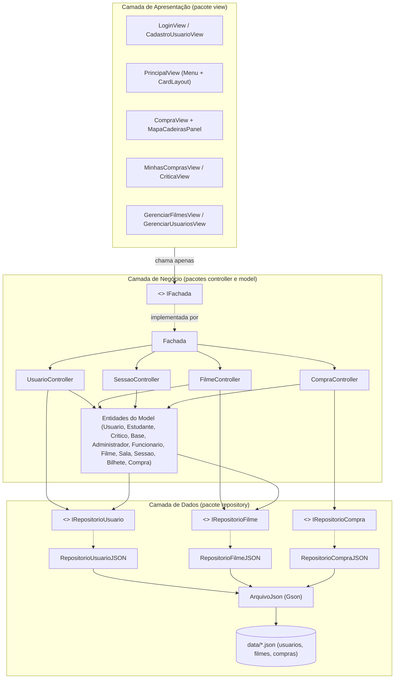

## Mapeamento dos pdf's x Código Implementado

### 🎬 ATO 1 (Parte 1) — Classes e Encapsulamento
| Exigência do Slide (Ato 1) | Onde e Como Foi Implementado no Código |
| :--- | :--- |
| **Atributos `private`, métodos `public`, construtores, getters e setters** | Todas as classes de [`src/model`] têm atributos `private`. Os construtores chamam os próprios `setters` (ex.: [`Usuario.java`], garantindo que nenhum objeto nasça inválido. |
| **Classe `Usuario`** (`user`, `CPF`, `senha`, `idade`, `sexo`, `email`, `nomeCartao`, `numeroCartao`, `codigoVerificador`) + realizar, alterar e cancelar compra | Implementada em [`Usuario.java`]. O método `comprarBilhete` gera o ingresso; as operações de realizar, alterar e cancelar compra são coordenadas por [`CompraController.java`] e [`Compra.java`] |
| **Classe `Filme`** (`nome`, `duração`, `sinopse`, `valor`) | Implementada em [`Filme.java`] |
| **Classe `Bilhete`** (`user`, `CPF`, `sala`, `sessão`, `filme`, `valor` calculado por filme e sala, `cadeira`) | Implementada em [`Bilhete.java`]. Calcula o preço inicial na linha 30: `this.valor = sala.calcularValorIngresso(sessao.getFilme())`. |
| **Classe `Sala`** (lista de sessões de tamanho fixo com grade de horário; horário sem sessão fica `null` e não aparece para o usuário) | Implementada em [`Sala.java`]. Possui o vetor estático `HORARIOS` com 7 horários (`10:00` às `22:00`) e o vetor fixo `Sessao[7]`. O método [`getSessoesDisponiveis()`] filtra posições `null`. |
| **Classe `Sessao`** (filme exibido + matriz de cadeiras `10 linhas x 15 colunas`) | Implementada em [`Sessao.java`] com `Cadeira[10][15]` (fileiras `A` a `J`, colunas `1` a `15`). |
| **Classe `Compra`** (itens de lanchonete com estoque infinito + 1 ou mais bilhetes; método de compra de bilhetes à parte; sugestão de cadeiras juntas) | Implementada em [`Compra.java`] e [`Sessao.buscarCadeirasJuntas(int quantidade)`] |

---

### 🎬 ATO 2 (Parte 2) — Herança, Sobrescrita, Sobrecarga e Enums
| Exigência do Slide (Ato 2) | Onde e Como Foi Implementado no Código |
| :--- | :--- |
| **Enum `Produtos`** (5 ou 6 produtos de balcão com `String nome` e `double valor` integrados à `Compra`) | [`Produtos.java`]: 6 itens (`PIPOCA` R\$ 18, `REFRIGERANTE` R\$ 9, `CHOCOLATE` R\$ 7,50, `AGUA` R\$ 5, `NACHOS` R\$ 16, `BALA` R\$ 4). |
| **Enum `CupomPromocional`** (3 cupons com descontos à escolha da equipe) | [`CupomPromocional.java`]: `BEMVINDO10` (10%), `CINEPOO20` (20%) e `QUARTA30` (30%), com método `aplicarDesconto(double valor)`. |
| **Enum de Salas** (`Comum 1.0`, `3D 1.2`, `XD 1.3`, `XD/3D 1.4`) e escolha do fluxo (`Sala -> Filme/Sessão`) | [`TipoSala.java`]. A equipe adotou o fluxo simplificado sugerido pelo professor: **escolha da Sala $\rightarrow$ escolha da Sessão/Filme**. |
| **Herança e Sobrescrita — `Estudante`** (herda tudo de `Usuario` e sobrescreve compra de bilhete para metade do valor) | [`Estudante.java`]: `@Override comprarBilhete(...)` chama `super.comprarBilhete(...)` e aplica `bilhete.setValor(bilhete.getValor() / 2)`. |
| **Herança e Sobrescrita — `Critico`** (herda de `Usuario`, atributo `origem`, compra de bilhete sempre zero, `atribuirNota` e `atribuirCritica`) | [`Critico.java`]: possui `private String origem`, `@Override comprarBilhete(...)` que define `bilhete.setValor(0.0)`, além de `atribuirNota(double nota, Filme filme)` e `atribuirCritica(String critica, Filme filme)`. |
| **Classe `Critica` e evolução de `Filme`** (`nota`, `quantidadeCriticos`, vetor `Critica[100]`) | [`Critica.java`] guarda `nome`, `origem` e `mensagem`. [`Filme.java`] tem `MAX_CRITICAS = 100`, recalcula a média em `adicionarNota` e insere no final do vetor em `adicionarCritica`. |
| **Sobrecarga nas Compras** (sobrecarregar compra de produtos e compra de bilhetes com `CupomPromocional`) | 1) Em [`Usuario.java`]: `comprarBilhete(Sala, Sessao, int, int, CupomPromocional)`. 2) Em [`Compra.java`]): `comprarProduto(Produtos, int)` e `comprarProduto(Produtos, int, CupomPromocional)`. |

---

### 🎬 ATO 3 (Parte 3) — Classes Abstratas, Interfaces, Exceções e Persistência
| Exigência do Slide (Ato 3) | Onde e Como Foi Implementado no Código |
| :--- | :--- |
| **Exceção `VendasException`** tratando os 3 erros de compra de bilhetes: 1) Horário do filme já passou; 2) Poltrona já selecionada; 3) Filme fora de cartaz. | [`VendasException.java`] define as 3 constantes (`SESSAO_INICIADA`, `POLTRONA_OCUPADA`, `FORA_DE_CARTAZ`) e guarda `motivo` e `filme`. É lançada em [`Usuario.comprarBilhete`], [`Compra.adicionarBilhete`] e [`CompraController.finalizar`] |
| **Classe Abstrata `Base`** (`nome`, `idade`, `email`, getters/setters e métodos abstratos `adicionarUsuario` e `alterarUsuario`) | [`Base.java`] |
| **Interface `GerenciaFilmes`** (`incluirFilme`, `excluirFilme`, `alterarFilme`) | [`GerenciaFilmes.java`] |
| **Classe Concreta `Funcionario`** (herda de `Base`, atributo `salario`, implementa métodos abstratos e `GerenciaFilmes`) | [`Funcionario.java`]. Não possui método de excluir usuário e delega a persistência ao `Administrador`. |
| **Classe Concreta `Administrador`** (herda de `Base`, atributos `salario` e `id`, implementa `Base` + `GerenciaFilmes` + `excluirUsuario` + responsável pela **Persistência**) | [`Administrador.java`]. Recebe `IRepositorioUsuario` e `IRepositorioFilme` e executa todas as gravações de usuários e filmes. |
| **Escolha da Tecnologia de Persistência** (Arquivos de texto, vetores, listas ou BD) | A equipe escolheu **Arquivos JSON (`data/*.json`) com a biblioteca Gson** (e listas `ArrayList` em memória), isolados pela camada `repository`. |

---

### 🎬 ATO 4 (Parte 4) — Padrões de Projeto e Justificativa
| Exigência do Slide (Ato 4) | Escolha da Equipe e Justificativa para a Apresentação |
| :--- | :--- |
| **Escolher um Padrão de Projeto, aplicá-lo ao sistema e justificar a escolha** | **Padrão Principal Escolhido: Fachada (*Facade*)** — [`IFachada.java`].  **Por que escolhemos o Facade (Justificativa):** 1. **Redução de Acoplamento:** O sistema possui 11 telas/componentes no pacote `view`, 4 controladores (`UsuarioController`, `FilmeController`, `SessaoController`, `CompraController`), 15 classes no `model` e 3 repositórios JSON. Sem a Fachada, cada tela precisaria conhecer e instanciar vários controladores e modelos. 2. **Ponto Único de Entrada:** As telas recebem apenas `IFachada`. Toda operação da interface gráfica resume-se a uma chamada na fachada (ex.: `fachada.finalizarCompra(carrinho)`). 3. **Coordenação entre Subsistemas:** Operações que envolvem mais de um controlador são orquestradas pela própria `Fachada`. Exemplo: em [`Fachada.excluirUsuario`], a fachada consulta primeiro o `compraController` para verificar se o cliente tem compras ativas antes de chamar o `usuarioController`. Em [`Fachada.excluirFilme`], ela consulta o `sessaoController` para impedir a exclusão de um filme que está na grade de hoje. |

> [!TIP]
> **Outros Padrões Presentes no Código:**
> - **MVC (Model-View-Controller):** Separação clara entre `model`, `view` e `controller`.
> - **Repository / DAO (Data Access Object):** Interfaces `IRepositorio...` desacoplam a lógica de negócio dos arquivos JSON.
> - **Observer (Listener):** Usado em [`MapaCadeirasPanel.java`] (`adicionarOuvinte` / `avisarOuvintes`) para notificar a `CompraView` sempre que o usuário clica em uma poltrona.

---

## Visão Geral da Arquitetura e Interação entre Camadas

O projeto foi construído com **Java 17**, interface gráfica em **Java Swing** e persistência em arquivos **JSON** (via biblioteca **Gson**). Ele adota uma **Arquitetura em 3 Camadas** combinada com **MVC**, o padrão **Fachada (Facade)** e o padrão **Repository (DAO)**.

> [!IMPORTANT]
> **Regra de Ouro da Arquitetura no Código:**
> - **As telas (`view`) nunca acessam `Controller`, `Repositorio` ou arquivos JSON diretamente:** elas conversam única e exclusivamente com a interface [`IFachada.java`].
> - **A camada de negócio (`controller` e `model`) não sabe que os dados são salvos em JSON:** ela conversa apenas com as interfaces [`IRepositorioUsuario.java`], [`IRepositorioFilme.java` e [`IRepositorioCompra.java`].

---
