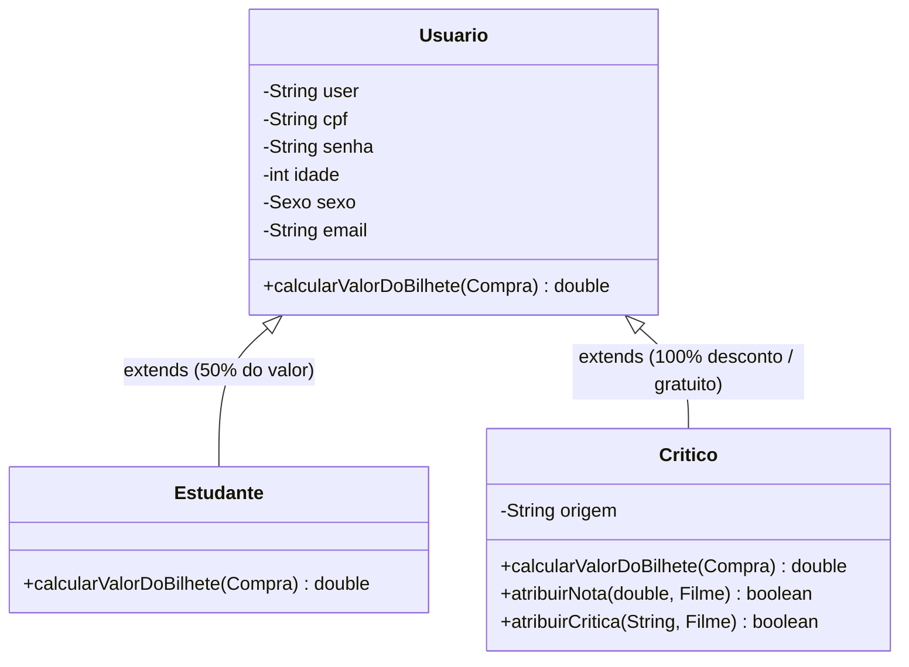
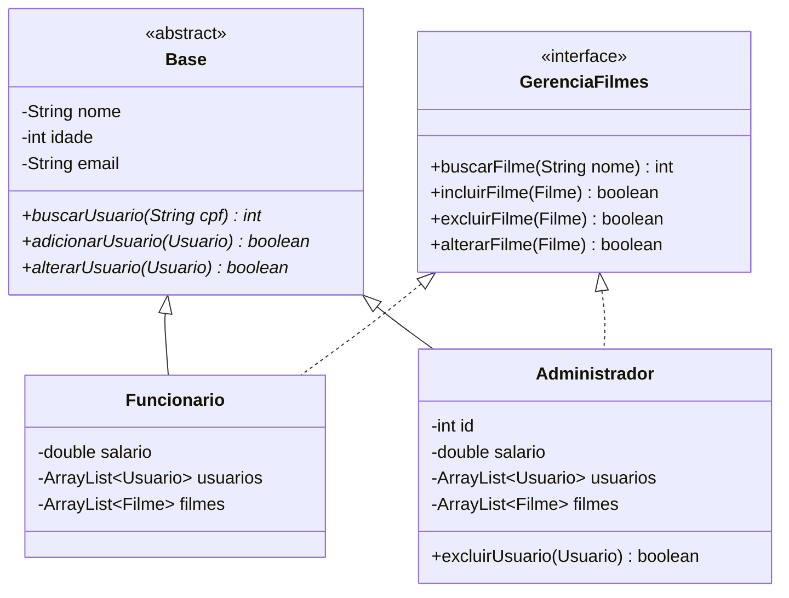

# 🎬 Documentação e Roteiro de Apresentação — Sistema de Cinema (POO)

> [!NOTE]
> **Contexto Acadêmico:** Disciplina de Programação Orientada a Objetos (UNICAP — Prof. Jheymesson A. Cavalcanti)  
> **Equipe:** Amanda Aziz, Francis Lauriano e Sofia Farias  
> **Formato da Apresentação Final (Ato 4):** **8 minutos** de apresentação + **10 minutos** de perguntas da banca/professor.

---

## 1. Visão Geral da Arquitetura do Projeto

O projeto evoluiu de um modelo orientado a objetos em console para uma aplicação gráfica completa em **Java Swing** estruturada no padrão arquitetural **MVC (Model-View-Controller)**, preparada para **Facade** e **DAO/Repository (JSON)**.

```mermaid
flowchart LR
    subgraph View ["Camada View (Java Swing)"]
        MV["MenuView"]
        UV["UsuarioView"]
        FV["FilmeView"]
        SV["SessaoView"]
        CV["CompraView"]
        CaV["CadeiraView"]
        CrV["CriticaView"]
    end

    subgraph Controller ["Camada Controller"]
        MC["MenuController"]
        UC["UsuarioController"]
        FC["FilmeController"]
        SC["SessaoController"]
        CC["CompraController"]
        CaC["CadeiraController"]
        CrC["CriticaController"]
        FAC["Facade / OperacoesCinema"]
    end

    subgraph Model ["Camada Model (Domínio POO)"]
        U["Usuario / Estudante / Critico"]
        B["Base / Funcionario / Administrador"]
        F["Filme / Critica"]
        S["Sala / Sessao / Cadeira"]
        Co["Compra / Bilhete"]
        E["Enums: Produtos, CupomPromocional, TipoSala, Sexo"]
    end

    subgraph Repository ["Camada Repository (Persistência)"]
        DAO["UsuarioDAO / FilmeDAO / CompraDAO"]
        JSON["ArquivoJson (filmes.json, usuarios.json)"]
    end

    View <-->|"Eventos / Atualização de Tela"| Controller
    Controller -->|"Manipula e Valida"| Model
    Controller -.->|"Delega Persistência"| Repository
    Repository --> JSON
```

---

## 2. O Que Foi Feito em Cada Etapa (Atos 1 a 4)

### 🎬 ATO 1 — Classes, Encapsulamento e Associações
Na primeira entrega foi construído o núcleo de domínio do cinema no pacote `model`, aplicando **encapsulamento estrito** (`private` para todos os atributos e `public` para construtores, *getters*, *setters* e métodos de negócio):

| Classe | Arquivo | O que foi implementado |
| :--- | :--- | :--- |
| **`Usuario`** | [Usuario.java](file:///C:/Users/Amanda%20Aziz/Documents/cinema/src/model/Usuario.java) | Atributos pessoais (`user`, `cpf`, `senha`, `idade`, `sexo`, `email`) e de pagamento (`nomeCartao`, `numeroCartao`, `codigoVerificador`). Método base [`calcularValorDoBilhete(Compra)`](file:///C:/Users/Amanda%20Aziz/Documents/cinema/src/model/Usuario.java#L29-L32). |
| **`Filme`** | [Filme.java](file:///C:/Users/Amanda%20Aziz/Documents/cinema/src/model/Filme.java) | Atributos `nome`, `duracao`, `sinopse`, `valor`, além do controle de notas, média e críticas e flag `emCartaz`. |
| **`Sala`** | [Sala.java](file:///C:/Users/Amanda%20Aziz/Documents/cinema/src/model/Sala.java) | Contém número da sala, [`TipoSala`](file:///C:/Users/Amanda%20Aziz/Documents/cinema/src/model/enums/TipoSala.java) e um vetor fixo `Sessao[10]`. Posições sem sessão permanecem `null` e são ocultadas da listagem para o usuário. |
| **`Sessao`** | [Sessao.java](file:///C:/Users/Amanda%20Aziz/Documents/cinema/src/model/Sessao.java) | Associa um `horario` e um `Filme` a uma **matriz fixa de poltronas `10x15`** (`Cadeira[10][15]`). Implementa ocupação/liberação de assento e o algoritmo de **sugestão de cadeiras contíguas na mesma fileira** ([`buscarCadeirasJuntas(int qtd)`](file:///C:/Users/Amanda%20Aziz/Documents/cinema/src/model/Sessao.java#L123-L151) e [`fazParteDeGrupo`](file:///C:/Users/Amanda%20Aziz/Documents/cinema/src/model/Sessao.java#L90-L118)). |
| **`Cadeira`** | [Cadeira.java](file:///C:/Users/Amanda%20Aziz/Documents/cinema/src/model/Cadeira.java) | Representa cada assento individual (`linha`, `coluna`, `ocupada`). |
| **`Bilhete`** | [Bilhete.java](file:///C:/Users/Amanda%20Aziz/Documents/cinema/src/model/Bilhete.java) | Vincula `user`, `cpf`, `Sala`, `Sessao`, `Filme` e `Cadeira`. Calcula automaticamente seu valor no construtor multiplicando o valor do filme pelo multiplicador do tipo da sala (`filme.getValor() * sala.getTipoSala().getMultiplicador()`). |
| **`Compra`** | [Compra.java](file:///C:/Users/Amanda%20Aziz/Documents/cinema/src/model/Compra.java) | Gerencia listas dinâmicas (`ArrayList`) de `Bilhete` e `Produtos` (com estoque infinito), quantidades e subtotais. Possui métodos separados para comprar/remover bilhetes, adicionar/editar/remover produtos e realizar/alterar/cancelar a compra (liberando as poltronas automaticamente ao cancelar em [`cancelarCompra()`](file:///C:/Users/Amanda%20Aziz/Documents/cinema/src/model/Compra.java#L326-L342)). |

---

### 🎬 ATO 2 — Herança, Sobrescrita, Sobrecarga e Enumerações
Na segunda etapa, o projeto ganhou especializações de usuário, cálculos polimórficos de ingresso, cupons e avaliações de críticos:

1. **Enumerações (`model.enums`)**:
   - [`Produtos`](file:///C:/Users/Amanda%20Aziz/Documents/cinema/src/model/enums/Produtos.java): `PIPOCA` (R\$ 12,00), `REFRIGERANTE` (R\$ 7,00), `CHOCOLATE` (R\$ 5,00), `AGUA` (R\$ 5,00), `BALA` (R\$ 4,00).
   - [`CupomPromocional`](file:///C:/Users/Amanda%20Aziz/Documents/cinema/src/model/enums/CupomPromocional.java): `CRITICO` (100%), `ESTUDANTE` (50%), `MAIS_60` (60%), `PROFESSOR` (50%), `MEMBROS_VIP` (70%).
   - [`TipoSala`](file:///C:/Users/Amanda%20Aziz/Documents/cinema/src/model/enums/TipoSala.java): `COMUM` (`1.0`), `SALA3D` (`1.2`), `XD` (`1.3`), `XD_3D` (`1.4`).
   - [`Sexo`](file:///C:/Users/Amanda%20Aziz/Documents/cinema/src/model/enums/Sexo.java): `F`, `M`, `NB`, `NI`.
2. **Herança e Sobrescrita (`@Override`)**:
   - [`Estudante`](file:///C:/Users/Amanda%20Aziz/Documents/cinema/src/model/Estudante.java): herda de `Usuario` e sobrescreve [`calcularValorDoBilhete(Compra)`](file:///C:/Users/Amanda%20Aziz/Documents/cinema/src/model/Estudante.java#L14-L17) retornando `compra.calcularTotalBilhetes() / 2` (meia-entrada).
   - [`Critico`](file:///C:/Users/Amanda%20Aziz/Documents/cinema/src/model/Critico.java): herda de `Usuario`, adiciona o atributo `origem`, sobrescreve [`calcularValorDoBilhete(Compra)`](file:///C:/Users/Amanda%20Aziz/Documents/cinema/src/model/Critico.java#L16-L19) aplicando 100% de desconto (valor zero) e implementa [`atribuirNota(double, Filme)`](file:///C:/Users/Amanda%20Aziz/Documents/cinema/src/model/Critico.java#L22-L27) e [`atribuirCritica(String, Filme)`](file:///C:/Users/Amanda%20Aziz/Documents/cinema/src/model/Critico.java#L29-L35).
3. **Classe [`Critica`](file:///C:/Users/Amanda%20Aziz/Documents/cinema/src/model/Critica.java) e Integração com [`Filme`](file:///C:/Users/Amanda%20Aziz/Documents/cinema/src/model/Filme.java)**:
   - `Filme` armazena até 100 críticas (`Critica[100]`) e 100 notas (`double[100]`), recalculando automaticamente a média em [`mediaDasNotas()`](file:///C:/Users/Amanda%20Aziz/Documents/cinema/src/model/Filme.java#L126-L139) sempre que uma nova nota entre 0 e 10 é inserida.
4. **Sobrecarga de Métodos (Overloading) em [`Compra`](file:///C:/Users/Amanda%20Aziz/Documents/cinema/src/model/Compra.java)**:
   - [`comprarBilhete(Bilhete)`](file:///C:/Users/Amanda%20Aziz/Documents/cinema/src/model/Compra.java#L68-L74) e [`comprarBilhete(Bilhete, CupomPromocional)`](file:///C:/Users/Amanda%20Aziz/Documents/cinema/src/model/Compra.java#L77-L88);
   - [`comprarProduto(Produtos, int)`](file:///C:/Users/Amanda%20Aziz/Documents/cinema/src/model/Compra.java#L142-L163) e [`comprarProduto(Produtos, int, CupomPromocional)`](file:///C:/Users/Amanda%20Aziz/Documents/cinema/src/model/Compra.java#L166-L187);
   - [`alterarQuantidadeProduto(Produtos, int)`](file:///C:/Users/Amanda%20Aziz/Documents/cinema/src/model/Compra.java#L192-L209) e [`alterarQuantidadeProduto(Produtos, int, CupomPromocional)`](file:///C:/Users/Amanda%20Aziz/Documents/cinema/src/model/Compra.java#L214-L233).

---

### 🎬 ATO 3 — Classes Abstratas, Interfaces, Exceções e Persistência
Na terceira etapa foram introduzidos contratos de administração do sistema, tratamento de erros de venda e estrutura de persistência:

1. **Classe Abstrata [`Base`](file:///C:/Users/Amanda%20Aziz/Documents/cinema/src/model/Base.java)**:
   - Contém `nome`, `idade` e `email`, além dos métodos abstratos `buscarUsuario`, `adicionarUsuario` e `alterarUsuario`.
2. **Interface [`GerenciaFilmes`](file:///C:/Users/Amanda%20Aziz/Documents/cinema/src/model/interfaces/GerenciaFilmes.java)**:
   - Define o contrato com `buscarFilme`, `incluirFilme`, `excluirFilme` e `alterarFilme`.
3. **Classes Concretas [`Administrador`](file:///C:/Users/Amanda%20Aziz/Documents/cinema/src/model/Administrador.java) e [`Funcionario`](file:///C:/Users/Amanda%20Aziz/Documents/cinema/src/model/Funcionario.java)**:
   - Ambas herdam de `Base` e implementam `GerenciaFilmes`, gerenciando coleções dinâmicas `ArrayList<Usuario>` e `ArrayList<Filme>`.
   - Diferença de escopo: `Administrador` possui `id` e o método exclusivo [`excluirUsuario(Usuario)`](file:///C:/Users/Amanda%20Aziz/Documents/cinema/src/model/Administrador.java#L86-L97), enquanto `Funcionario` possui apenas `salario` e não pode excluir usuários.
4. **Exceção Personalizada [`VendasException`](file:///C:/Users/Amanda%20Aziz/Documents/cinema/src/controller/exceptions/VendasException.java)**:
   - Estende `Exception` e cobre exatamente os **3 cenários exigidos no PDF 3** por meio de *Static Factory Methods* e um `enum Tipo`:
     - [`sessaoJaIniciada(filme, horario)`](file:///C:/Users/Amanda%20Aziz/Documents/cinema/src/controller/exceptions/VendasException.java#L22-L24) — apoiado por [`Sessao.jaComecou()`](file:///C:/Users/Amanda%20Aziz/Documents/cinema/src/model/Sessao.java#L272-L275) com `LocalTime`;
     - [`poltronaOcupada(linha, coluna)`](file:///C:/Users/Amanda%20Aziz/Documents/cinema/src/controller/exceptions/VendasException.java#L26-L28) — apoiado por [`Sessao.cadeiraDisponivel(l, c)`](file:///C:/Users/Amanda%20Aziz/Documents/cinema/src/model/Sessao.java#L45-L52);
     - [`filmeForaDeCartaz(filme)`](file:///C:/Users/Amanda%20Aziz/Documents/cinema/src/controller/exceptions/VendasException.java#L30-L32) — apoiado por [`Filme.isEmCartaz()`](file:///C:/Users/Amanda%20Aziz/Documents/cinema/src/model/Filme.java#L145-L147).
   - Outras exceções de domínio estruturadas no pacote `controller.exceptions` e `repository.exceptions`: [`CompraException`](file:///C:/Users/Amanda%20Aziz/Documents/cinema/src/controller/exceptions/CompraException.java), [`FilmeException`](file:///C:/Users/Amanda%20Aziz/Documents/cinema/src/controller/exceptions/FilmeException.java), [`SessaoException`](file:///C:/Users/Amanda%20Aziz/Documents/cinema/src/controller/exceptions/SessaoException.java), [`UsuarioException`](file:///C:/Users/Amanda%20Aziz/Documents/cinema/src/controller/exceptions/UsuarioException.java), [`ValidacaoException`](file:///C:/Users/Amanda%20Aziz/Documents/cinema/src/controller/exceptions/ValidacaoException.java) e [`PersistenciaException`](file:///C:/Users/Amanda%20Aziz/Documents/cinema/src/repository/exceptions/PersistenciaException.java).
5. **Persistência de Dados**:
   - Em memória via `ArrayList<Usuario>`, `ArrayList<Filme>`, `ArrayList<Compra>` e `HashMap<String, Usuario>`;
   - Estrutura de arquivos JSON em [`data/filmes.json`](file:///C:/Users/Amanda%20Aziz/Documents/cinema/data/filmes.json) e [`data/usuarios.json`](file:///C:/Users/Amanda%20Aziz/Documents/cinema/data/usuarios.json) com biblioteca **Gson** configurada no [`pom.xml`](file:///C:/Users/Amanda%20Aziz/Documents/cinema/pom.xml).

---

### 🎬 ATO 4 — Padrões de Projeto Aplicados e Justificativa

Para responder ao requisito principal do **PDF 4 ("Escolha um padrão de projeto, aplique ao projeto e apresente a justificativa")**, vocês têm **3 padrões claros** presentes na arquitetura para destacar na apresentação:

1. **MVC (Model-View-Controller)** — *Padrão Arquitetural Principal (100% funcional)*:
   - **Onde está aplicado:** Separação estrita entre pacotes `model` (regras de negócio e entidades), `view` (7 telas em Java Swing: [`MenuView`](file:///C:/Users/Amanda%20Aziz/Documents/cinema/src/view/MenuView.java), [`UsuarioView`](file:///C:/Users/Amanda%20Aziz/Documents/cinema/src/view/UsuarioView.java), [`FilmeView`](file:///C:/Users/Amanda%20Aziz/Documents/cinema/src/view/FilmeView.java), [`SessaoView`](file:///C:/Users/Amanda%20Aziz/Documents/cinema/src/view/SessaoView.java), [`CompraView`](file:///C:/Users/Amanda%20Aziz/Documents/cinema/src/view/CompraView.java), [`CadeiraView`](file:///C:/Users/Amanda%20Aziz/Documents/cinema/src/view/CadeiraView.java), [`CriticaView`](file:///C:/Users/Amanda%20Aziz/Documents/cinema/src/view/CriticaView.java)) e `controller` (7 controladores que escutam eventos dos botões e coordenam o `model` e a `view`).
   - **Justificativa:** Desacopla a interface gráfica (Swing) das regras de negócio. Permitiu migrar o sistema do terminal (console) para janelas gráficas sem precisar reescrever os cálculos de `Compra`, `Bilhete`, `Sessao` ou `Filme`.
2. **Static Factory Method (Método Fábrica Estático)** — *Padrão Criacional (100% funcional)*:
   - **Onde está aplicado:** Na classe [`VendasException`](file:///C:/Users/Amanda%20Aziz/Documents/cinema/src/controller/exceptions/VendasException.java#L22-L32), com os métodos `VendasException.sessaoJaIniciada(...)`, `VendasException.poltronaOcupada(...)` e `VendasException.filmeForaDeCartaz(...)`.
   - **Justificativa:** Em vez de espalhar strings de erro e tipos de enum manualmente pelo código ao lançar uma exceção, os métodos fábrica criam a exceção já padronizada com o tipo correto e a mensagem formatada, aumentando a legibilidade e evitando erros.
3. **Facade + DAO/Repository** — *Padrões Estrutural e de Persistência (Roteiro/Arquitetura)*:
   - **Onde está projetado:** Interface [`OperacoesCinema`](file:///C:/Users/Amanda%20Aziz/Documents/cinema/src/controller/interfaces/OperacoesCinema.java) + classe [`Facade`](file:///C:/Users/Amanda%20Aziz/Documents/cinema/src/controller/Facade.java) e pacote `repository` (`UsuarioDAO`, `FilmeDAO`, `CompraDAO`).
   - **Justificativa:** A `Facade` fornece uma interface única para os `Controllers` acessarem as operações do sistema, enquanto os `DAOs` isolam a leitura e escrita nos arquivos JSON.
