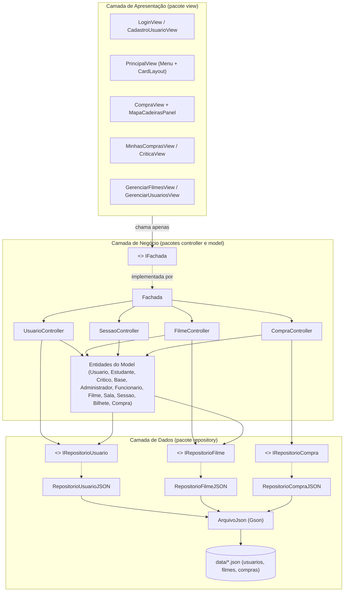
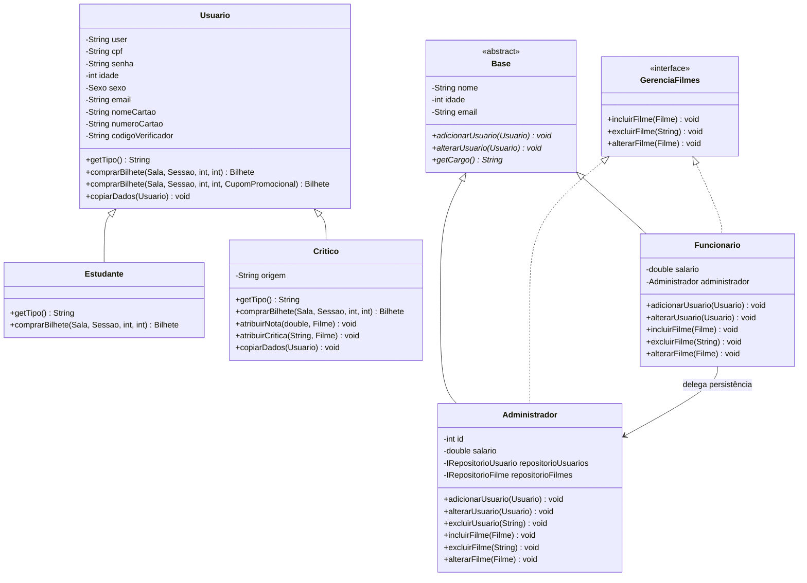

# 🎬 Documentação Completa e Guia de Apresentação — Sistema de Cinema (POO)

Este documento reúne a análise de **100% dos arquivos de código** do projeto em [`C:/Users/Amanda Aziz/Documents/cinema`](file:///C:/Users/Amanda%20Aziz/Documents/cinema), cruzando cada implementação com as exigências dos **4 slides do professor (Atos 1 a 4)**, explicando como todas as classes interagem entre si e trazendo um guia completo de **perguntas e respostas** para a apresentação.

---

## 1. Visão Geral da Arquitetura e Interação entre Camadas

O projeto foi construído com **Java 17**, interface gráfica em **Java Swing** e persistência em arquivos **JSON** (via biblioteca **Gson**). Ele adota uma **Arquitetura em 3 Camadas** combinada com **MVC**, o padrão **Fachada (Facade)** e o padrão **Repository (DAO)**.



> [!IMPORTANT]
> **Regra de Ouro da Arquitetura no Código:**
> - **As telas (`view`) nunca acessam `Controller`, `Repositorio` ou arquivos JSON diretamente:** elas conversam única e exclusivamente com a interface [`IFachada.java`](file:///C:/Users/Amanda%20Aziz/Documents/cinema/src/controller/IFachada.java).
> - **A camada de negócio (`controller` e `model`) não sabe que os dados são salvos em JSON:** ela conversa apenas com as interfaces [`IRepositorioUsuario.java`](file:///C:/Users/Amanda%20Aziz/Documents/cinema/src/repository/IRepositorioUsuario.java), [`IRepositorioFilme.java`](file:///C:/Users/Amanda%20Aziz/Documents/cinema/src/repository/IRepositorioFilme.java) e [`IRepositorioCompra.java`](file:///C:/Users/Amanda%20Aziz/Documents/cinema/src/repository/IRepositorioCompra.java).

---

## 2. Mapeamento dos 4 Slides do Professor vs. Código Implementado

### 🎬 ATO 1 (Parte 1) — Classes e Encapsulamento
| Exigência do Slide (Ato 1) | Onde e Como Foi Implementado no Código |
| :--- | :--- |
| **Atributos `private`, métodos `public`, construtores, getters e setters** | Todas as classes de [`src/model`](file:///C:/Users/Amanda%20Aziz/Documents/cinema/src/model) têm atributos `private`. Os construtores chamam os próprios `setters` (ex.: [`Usuario.java`](file:///C:/Users/Amanda%20Aziz/Documents/cinema/src/model/Usuario.java#L25-L37)), garantindo que nenhum objeto nasça inválido. |
| **Classe `Usuario`** (`user`, `CPF`, `senha`, `idade`, `sexo`, `email`, `nomeCartao`, `numeroCartao`, `codigoVerificador`) + realizar, alterar e cancelar compra | Implementada em [`Usuario.java`](file:///C:/Users/Amanda%20Aziz/Documents/cinema/src/model/Usuario.java#L13-L202). O método `comprarBilhete` gera o ingresso; as operações de realizar, alterar e cancelar compra são coordenadas por [`CompraController.java`](file:///C:/Users/Amanda%20Aziz/Documents/cinema/src/controller/CompraController.java) e [`Compra.java`](file:///C:/Users/Amanda%20Aziz/Documents/cinema/src/model/Compra.java). |
| **Classe `Filme`** (`nome`, `duração`, `sinopse`, `valor`) | Implementada em [`Filme.java`](file:///C:/Users/Amanda%20Aziz/Documents/cinema/src/model/Filme.java#L10-L35). |
| **Classe `Bilhete`** (`user`, `CPF`, `sala`, `sessão`, `filme`, `valor` calculado por filme e sala, `cadeira`) | Implementada em [`Bilhete.java`](file:///C:/Users/Amanda%20Aziz/Documents/cinema/src/model/Bilhete.java#L10-L33). Calcula o preço inicial na linha 30: `this.valor = sala.calcularValorIngresso(sessao.getFilme())`. |
| **Classe `Sala`** (lista de sessões de tamanho fixo com grade de horário; horário sem sessão fica `null` e não aparece para o usuário) | Implementada em [`Sala.java`](file:///C:/Users/Amanda%20Aziz/Documents/cinema/src/model/Sala.java#L12-L50). Possui o vetor estático `HORARIOS` com 7 horários (`10:00` às `22:00`) e o vetor fixo `Sessao[7]`. O método [`getSessoesDisponiveis()`](file:///C:/Users/Amanda%20Aziz/Documents/cinema/src/model/Sala.java#L42-L50) filtra posições `null`. |
| **Classe `Sessao`** (filme exibido + matriz de cadeiras `10 linhas x 15 colunas`) | Implementada em [`Sessao.java`](file:///C:/Users/Amanda%20Aziz/Documents/cinema/src/model/Sessao.java#L9-L28) com `Cadeira[10][15]` (fileiras `A` a `J`, colunas `1` a `15`). |
| **Classe `Compra`** (itens de lanchonete com estoque infinito + 1 ou mais bilhetes; método de compra de bilhetes à parte; sugestão de cadeiras juntas) | Implementada em [`Compra.java`](file:///C:/Users/Amanda%20Aziz/Documents/cinema/src/model/Compra.java) e [`Sessao.buscarCadeirasJuntas(int quantidade)`](file:///C:/Users/Amanda%20Aziz/Documents/cinema/src/model/Sessao.java#L61-L86). |

---

### 🎬 ATO 2 (Parte 2) — Herança, Sobrescrita, Sobrecarga e Enums
| Exigência do Slide (Ato 2) | Onde e Como Foi Implementado no Código |
| :--- | :--- |
| **Enum `Produtos`** (5 ou 6 produtos de balcão com `String nome` e `double valor` integrados à `Compra`) | [`Produtos.java`](file:///C:/Users/Amanda%20Aziz/Documents/cinema/src/model/enums/Produtos.java): 6 itens (`PIPOCA` R\$ 18, `REFRIGERANTE` R\$ 9, `CHOCOLATE` R\$ 7,50, `AGUA` R\$ 5, `NACHOS` R\$ 16, `BALA` R\$ 4). |
| **Enum `CupomPromocional`** (3 cupons com descontos à escolha da equipe) | [`CupomPromocional.java`](file:///C:/Users/Amanda%20Aziz/Documents/cinema/src/model/enums/CupomPromocional.java): `BEMVINDO10` (10%), `CINEPOO20` (20%) e `QUARTA30` (30%), com método `aplicarDesconto(double valor)`. |
| **Enum de Salas** (`Comum 1.0`, `3D 1.2`, `XD 1.3`, `XD/3D 1.4`) e escolha do fluxo (`Sala -> Filme/Sessão`) | [`TipoSala.java`](file:///C:/Users/Amanda%20Aziz/Documents/cinema/src/model/enums/TipoSala.java). A equipe adotou o fluxo simplificado sugerido pelo professor: **escolha da Sala $\rightarrow$ escolha da Sessão/Filme**. |
| **Herança e Sobrescrita — `Estudante`** (herda tudo de `Usuario` e sobrescreve compra de bilhete para metade do valor) | [`Estudante.java`](file:///C:/Users/Amanda%20Aziz/Documents/cinema/src/model/Estudante.java#L24-L31): `@Override comprarBilhete(...)` chama `super.comprarBilhete(...)` e aplica `bilhete.setValor(bilhete.getValor() / 2)`. |
| **Herança e Sobrescrita — `Critico`** (herda de `Usuario`, atributo `origem`, compra de bilhete sempre zero, `atribuirNota` e `atribuirCritica`) | [`Critico.java`](file:///C:/Users/Amanda%20Aziz/Documents/cinema/src/model/Critico.java#L11-L56): possui `private String origem`, `@Override comprarBilhete(...)` que define `bilhete.setValor(0.0)`, além de `atribuirNota(double nota, Filme filme)` e `atribuirCritica(String critica, Filme filme)`. |
| **Classe `Critica` e evolução de `Filme`** (`nota`, `quantidadeCriticos`, vetor `Critica[100]`) | [`Critica.java`](file:///C:/Users/Amanda%20Aziz/Documents/cinema/src/model/Critica.java) guarda `nome`, `origem` e `mensagem`. [`Filme.java`](file:///C:/Users/Amanda%20Aziz/Documents/cinema/src/model/Filme.java#L12-L60) tem `MAX_CRITICAS = 100`, recalcula a média em `adicionarNota` e insere no final do vetor em `adicionarCritica`. |
| **Sobrecarga nas Compras** (sobrecarregar compra de produtos e compra de bilhetes com `CupomPromocional`) | 1) Em [`Usuario.java`](file:///C:/Users/Amanda%20Aziz/Documents/cinema/src/model/Usuario.java#L89-L98): `comprarBilhete(Sala, Sessao, int, int, CupomPromocional)`.<br>2) Em [`Compra.java`](file:///C:/Users/Amanda%20Aziz/Documents/cinema/src/model/Compra.java#L61-L89): `comprarProduto(Produtos, int)` e `comprarProduto(Produtos, int, CupomPromocional)`. |

---

### 🎬 ATO 3 (Parte 3) — Classes Abstratas, Interfaces, Exceções e Persistência
| Exigência do Slide (Ato 3) | Onde e Como Foi Implementado no Código |
| :--- | :--- |
| **Exceção `VendasException`** tratando os 3 erros de compra de bilhetes:<br>1) Horário do filme já passou;<br>2) Poltrona já selecionada;<br>3) Filme fora de cartaz. | [`VendasException.java`](file:///C:/Users/Amanda%20Aziz/Documents/cinema/src/exceptions/VendasException.java) define as 3 constantes (`SESSAO_INICIADA`, `POLTRONA_OCUPADA`, `FORA_DE_CARTAZ`) e guarda `motivo` e `filme`. É lançada em [`Usuario.comprarBilhete`](file:///C:/Users/Amanda%20Aziz/Documents/cinema/src/model/Usuario.java#L60-L81), [`Compra.adicionarBilhete`](file:///C:/Users/Amanda%20Aziz/Documents/cinema/src/model/Compra.java#L34-L41) e [`CompraController.finalizar`](file:///C:/Users/Amanda%20Aziz/Documents/cinema/src/controller/CompraController.java#L113-L127). |
| **Classe Abstrata `Base`** (`nome`, `idade`, `email`, getters/setters e métodos abstratos `adicionarUsuario` e `alterarUsuario`) | [`Base.java`](file:///C:/Users/Amanda%20Aziz/Documents/cinema/src/model/Base.java#L13-L62). |
| **Interface `GerenciaFilmes`** (`incluirFilme`, `excluirFilme`, `alterarFilme`) | [`GerenciaFilmes.java`](file:///C:/Users/Amanda%20Aziz/Documents/cinema/src/model/interfaces/GerenciaFilmes.java). |
| **Classe Concreta `Funcionario`** (herda de `Base`, atributo `salario`, implementa métodos abstratos e `GerenciaFilmes`) | [`Funcionario.java`](file:///C:/Users/Amanda%20Aziz/Documents/cinema/src/model/Funcionario.java#L16-L58). Não possui método de excluir usuário e delega a persistência ao `Administrador`. |
| **Classe Concreta `Administrador`** (herda de `Base`, atributos `salario` e `id`, implementa `Base` + `GerenciaFilmes` + `excluirUsuario` + responsável pela **Persistência**) | [`Administrador.java`](file:///C:/Users/Amanda%20Aziz/Documents/cinema/src/model/Administrador.java#L18-L120). Recebe `IRepositorioUsuario` e `IRepositorioFilme` e executa todas as gravações de usuários e filmes. |
| **Escolha da Tecnologia de Persistência** (Arquivos de texto, vetores, listas ou BD) | A equipe escolheu **Arquivos JSON (`data/*.json`) com a biblioteca Gson** (e listas `ArrayList` em memória), isolados pela camada `repository`. |

---

### 🎬 ATO 4 (Parte 4) — Padrões de Projeto e Justificativa
| Exigência do Slide (Ato 4) | Escolha da Equipe e Justificativa para a Apresentação |
| :--- | :--- |
| **Escolher um Padrão de Projeto, aplicá-lo ao sistema e justificar a escolha** | **Padrão Principal Escolhido: Fachada (*Facade*)** — [`IFachada.java`](file:///C:/Users/Amanda%20Aziz/Documents/cinema/src/controller/IFachada.java) e [`Fachada.java`](file:///C:/Users/Amanda%20Aziz/Documents/cinema/src/controller/Fachada.java).<br><br>**Por que escolhemos o Facade (Justificativa):**<br>1. **Redução de Acoplamento:** O sistema possui 11 telas/componentes no pacote `view`, 4 controladores (`UsuarioController`, `FilmeController`, `SessaoController`, `CompraController`), 15 classes no `model` e 3 repositórios JSON. Sem a Fachada, cada tela precisaria conhecer e instanciar vários controladores e modelos.<br>2. **Ponto Único de Entrada:** As telas recebem apenas `IFachada`. Toda operação da interface gráfica resume-se a uma chamada na fachada (ex.: `fachada.finalizarCompra(carrinho)`).<br>3. **Coordenação entre Subsistemas:** Operações que envolvem mais de um controlador são orquestradas pela própria `Fachada`. Exemplo: em [`Fachada.excluirUsuario`](file:///C:/Users/Amanda%20Aziz/Documents/cinema/src/controller/Fachada.java#L96-L99), a fachada consulta primeiro o `compraController` para verificar se o cliente tem compras ativas antes de chamar o `usuarioController`. Em [`Fachada.excluirFilme`](file:///C:/Users/Amanda%20Aziz/Documents/cinema/src/controller/Fachada.java#L124-L130), ela consulta o `sessaoController` para impedir a exclusão de um filme que está na grade de hoje. |

> [!TIP]
> **Outros Padrões Presentes no Código (Bônus para citar se o professor perguntar):**
> - **MVC (Model-View-Controller):** Separação clara entre `model`, `view` e `controller`.
> - **Repository / DAO (Data Access Object):** Interfaces `IRepositorio...` desacoplam a lógica de negócio dos arquivos JSON.
> - **Observer (Listener):** Usado em [`MapaCadeirasPanel.java`](file:///C:/Users/Amanda%20Aziz/Documents/cinema/src/view/MapaCadeirasPanel.java#L235-L243) (`adicionarOuvinte` / `avisarOuvintes`) para notificar a `CompraView` sempre que o usuário clica em uma poltrona.

---

## 3. Explicação Detalhada da Estrutura do Código (Pacote por Pacote)

### 3.1. Raiz (`src/Main.java`)
- **[`Main.java`](file:///C:/Users/Amanda%20Aziz/Documents/cinema/src/Main.java):** Ponto de entrada do programa. Aplica o tema visual do Swing (`Estilo.aplicarTema()`), instancia a fachada dentro da thread de eventos do Swing (`IFachada fachada = new Fachada()`) — o que já carrega todos os arquivos JSON e monta a programação das salas — e abre a tela de login (`new LoginView(fachada).iniciar()`).

---

### 3.2. Pacote `model` (Entidades, Regras de Domínio, Enums e Interfaces)



#### Hierarquia de Clientes:
1. **[`Usuario.java`](file:///C:/Users/Amanda%20Aziz/Documents/cinema/src/model/Usuario.java):** Superclasse dos clientes.
   - **Encapsulamento e Validação:** Todos os 9 atributos são `private` e validados nos `setters` com auxílio da classe [`Validador.java`](file:///C:/Users/Amanda%20Aziz/Documents/cinema/src/model/Validador.java) (`user` e `nomeCartao` só aceitam letras; `cpf` exige 11 dígitos; `numeroCartao` exige 16 dígitos; `codigoVerificador` exige 3 dígitos; `senha` mínimo de 4 caracteres).
   - **Método `comprarBilhete(Sala, Sessao, int linha, int coluna)`:** Verifica as 3 regras da `VendasException` (filme fora de cartaz, sessão já iniciada, poltrona ocupada) e retorna `new Bilhete(this, sala, sessao, linha, coluna)`.
   - **Sobrecarga `comprarBilhete(..., CupomPromocional cupom)`:** Chama `comprarBilhete(sala, sessao, linha, coluna)` (aproveitando o polimorfismo caso o objeto seja `Estudante` ou `Critico`) e aplica o desconto do cupom sobre o valor resultante.
2. **[`Estudante.java`](file:///C:/Users/Amanda%20Aziz/Documents/cinema/src/model/Estudante.java):** Subclasse de `Usuario`. Sobrescreve `getTipo()` (`"Estudante"`) e `comprarBilhete(...)`, chamando `super.comprarBilhete(...)` e dividindo o valor do bilhete por 2 (`meia-entrada`).
3. **[`Critico.java`](file:///C:/Users/Amanda%20Aziz/Documents/cinema/src/model/Critico.java):** Subclasse de `Usuario`. Adiciona o atributo `private String origem`. Sobrescreve `comprarBilhete(...)` zerando o valor (`0.0`). Implementa `atribuirNota(double nota, Filme filme)` e `atribuirCritica(String critica, Filme filme)`. Também sobrescreve `copiarDados(Usuario outro)` para atualizar a `origem` quando o cadastro é editado.

#### Hierarquia da Equipe do Cinema:
4. **[`Base.java`](file:///C:/Users/Amanda%20Aziz/Documents/cinema/src/model/Base.java):** Classe abstrata com `nome`, `idade` e `email`. Define os métodos abstratos `adicionarUsuario(Usuario)`, `alterarUsuario(Usuario)` e `getCargo()`.
5. **[`GerenciaFilmes.java`](file:///C:/Users/Amanda%20Aziz/Documents/cinema/src/model/interfaces/GerenciaFilmes.java):** Interface com os contratos `incluirFilme(Filme)`, `excluirFilme(String)` e `alterarFilme(Filme)`.
6. **[`Administrador.java`](file:///C:/Users/Amanda%20Aziz/Documents/cinema/src/model/Administrador.java):** Estende `Base` e implementa `GerenciaFilmes`. Possui `id` e `salario`, além das referências para `IRepositorioUsuario` e `IRepositorioFilme`. É quem efetivamente valida duplicidade de CPF/nome de filme e grava nos repositórios. Possui o método exclusivo `excluirUsuario(String cpf)`.
7. **[`Funcionario.java`](file:///C:/Users/Amanda%20Aziz/Documents/cinema/src/model/Funcionario.java):** Estende `Base` e implementa `GerenciaFilmes`. Possui `salario` e uma referência para o `Administrador`, para quem **delega** as chamadas de `adicionarUsuario`, `alterarUsuario`, `incluirFilme`, `alterarFilme` e `excluirFilme`. Não pode excluir usuários.

#### Filmes, Salas, Sessões, Poltronas e Compras:
8. **[`Filme.java`](file:///C:/Users/Amanda%20Aziz/Documents/cinema/src/model/Filme.java):** Contém `nome`, `duracao`, `sinopse`, `valor`, `emCartaz`, `nota` (média), `quantidadeCriticos`, `Critica[] criticas` (tamanho fixo `MAX_CRITICAS = 100`) e o contador `quantidadeComentarios`.
   - **Cálculo da média em `adicionarNota(double novaNota)`:** Multiplica a média atual pela quantidade anterior (`double soma = nota * quantidadeCriticos`), incrementa `quantidadeCriticos++` e divide `(soma + novaNota) / quantidadeCriticos`.
9. **[`Critica.java`](file:///C:/Users/Amanda%20Aziz/Documents/cinema/src/model/Critica.java):** Guarda `nome` do crítico, `origem` e `mensagem`.
10. **[`Sala.java`](file:///C:/Users/Amanda%20Aziz/Documents/cinema/src/model/Sala.java):** Possui `numero`, `TipoSala` e um vetor fixo `Sessao[7]` correspondente à constante `HORARIOS = {"10:00", "12:00", "14:00", "16:00", "18:00", "20:00", "22:00"}`. Calcula o preço do ingresso na sala com `filme.getValor() * tipoSala.getMultiplicador()`.
11. **[`Sessao.java`](file:///C:/Users/Amanda%20Aziz/Documents/cinema/src/model/Sessao.java):** Associa um `horario` (`HH:mm`), um `Filme` e uma matriz `Cadeira[10][15]`.
    - **`jaComecou()`:** Usa `LocalTime.now().isAfter(LocalTime.parse(horario))` para saber se o horário da sessão já passou.
    - **`buscarCadeirasJuntas(int quantidade)`:** Procura grupos de poltronas livres contíguas na mesma fileira, varrendo na ordem `int[] ordemFileiras = {4, 5, 3, 6, 2, 7, 1, 8, 0, 9}` (do meio da sala para as pontas).
12. **[`Cadeira.java`](file:///C:/Users/Amanda%20Aziz/Documents/cinema/src/model/Cadeira.java):** Representa cada assento individual na matriz `10x15`, com `linha`, `coluna` e `boolean ocupada`.
13. **[`Bilhete.java`](file:///C:/Users/Amanda%20Aziz/Documents/cinema/src/model/Bilhete.java):** Guarda os dados do ingresso comprado (`user`, `cpf`, `numeroSala`, `tipoSala`, `horarioSessao`, `filme`, `valor`, `linha`, `coluna`). Armazena valores simples em vez de referências cíclicas de objetos para facilitar a serialização limpa no JSON.
14. **[`Compra.java`](file:///C:/Users/Amanda%20Aziz/Documents/cinema/src/model/Compra.java):** Reúne `id`, `cpfUsuario`, `nomeUsuario`, `dataHora`, `CupomPromocional cupom`, `ArrayList<Bilhete> bilhetes` e `ArrayList<ItemCompra> produtos`. Possui métodos separados para bilhetes (`adicionarBilhete`, `removerBilhete`) e produtos (`comprarProduto` sobrecarregado com e sem `CupomPromocional`).
15. **[`ItemCompra.java`](file:///C:/Users/Amanda%20Aziz/Documents/cinema/src/model/ItemCompra.java):** Representa uma linha de produto da lanchonete dentro de `Compra` (`Produtos produto`, `int quantidade`, `double subtotal`).
16. **[`Validador.java`](file:///C:/Users/Amanda%20Aziz/Documents/cinema/src/model/Validador.java):** Classe utilitária com métodos estáticos que validam campos obrigatórios, apenas letras, quantidade exata de dígitos numéricos, formato de e-mail, faixa de idade (0 a 120) e limpeza de pontuação de CPF.

---

### 3.3. Pacote `controller` (Fachada e Controladores de Negócio)
1. **[`IFachada.java`](file:///C:/Users/Amanda%20Aziz/Documents/cinema/src/controller/IFachada.java) e [`Fachada.java`](file:///C:/Users/Amanda%20Aziz/Documents/cinema/src/controller/Fachada.java):** Implementam o padrão **Facade**. No construtor da `Fachada`, são criados os 3 repositórios JSON, as instâncias de `Administrador` e `Funcionario`, e os 4 controladores.
2. **[`UsuarioController.java`](file:///C:/Users/Amanda%20Aziz/Documents/cinema/src/controller/UsuarioController.java):** Faz a autenticação de clientes (`entrarCliente` por CPF/senha) e da equipe (`entrarEquipe` por e-mail/senha fixos), além de repassar cadastro/alteração polimorficamente para `Base responsavel` e garantir que apenas `instaceof Administrador` possa excluir usuários (e somente se `possuiCompras == false`).
3. **[`FilmeController.java`](file:///C:/Users/Amanda%20Aziz/Documents/cinema/src/controller/FilmeController.java):** Recebe um `GerenciaFilmes gerente` (polimorfismo de interface: aceita tanto `Administrador` quanto `Funcionario`) para incluir, alterar e excluir filmes, e coordena `avaliar(Critico, Filme, nota, texto)` salvando no `IRepositorioFilme`.
4. **[`SessaoController.java`](file:///C:/Users/Amanda%20Aziz/Documents/cinema/src/controller/SessaoController.java):** Ao iniciar o sistema, executa `montarProgramacao(filmes)`: cria as 4 salas (`Sala 1 Comum`, `Sala 2 3D`, `Sala 3 XD`, `Sala 4 XD/3D`) e distribui os filmes `emCartaz` pelos 7 horários. De propósito, quando `(s + h) % 4 == 3`, deixa o horário `null` para cumprir o requisito do Ato 1 de horários vagos na grade. Também ocupa/libera cadeiras conforme as compras salvas.
5. **[`CompraController.java`](file:///C:/Users/Amanda%20Aziz/Documents/cinema/src/controller/CompraController.java):** No construtor, lê todas as compras já salvas em `data/compras.json` e marca suas poltronas como ocupadas nas sessões. Controla o carrinho (`adicionarIngressos`, `adicionarProduto`, `removerItemDoCarrinho`), a finalização da compra (`finalizar`), o cancelamento (`cancelar`, que devolve as cadeiras para o estado livre) e a alteração de compras já concluídas (`removerItemDaCompra` e `adicionarProdutoNaCompra`).

---

### 3.4. Pacote `repository` (Persistência em JSON com Gson)
1. **[`IRepositorioUsuario.java`](file:///C:/Users/Amanda%20Aziz/Documents/cinema/src/repository/IRepositorioUsuario.java), [`IRepositorioFilme.java`](file:///C:/Users/Amanda%20Aziz/Documents/cinema/src/repository/IRepositorioFilme.java), [`IRepositorioCompra.java`](file:///C:/Users/Amanda%20Aziz/Documents/cinema/src/repository/IRepositorioCompra.java):** Contratos CRUD da camada de dados.
2. **[`ArquivoJson.java`](file:///C:/Users/Amanda%20Aziz/Documents/cinema/src/repository/ArquivoJson.java):** Centraliza a leitura (`FileReader`) e escrita (`FileWriter`) usando `GsonBuilder().setPrettyPrinting().create()`. Possui bloco `finally` explícito para garantir o fechamento do arquivo mesmo em caso de erro.
3. **[`RepositorioUsuarioJSON.java`](file:///C:/Users/Amanda%20Aziz/Documents/cinema/src/repository/RepositorioUsuarioJSON.java):** Persiste em `data/usuarios.json`. Ao gravar, adiciona a propriedade `"tipo"` (`"Cliente"`, `"Estudante"` ou `"Crítico"`); ao carregar, lê `"tipo"` para instanciar a subclasse correta (`Usuario.class`, `Estudante.class` ou `Critico.class`), preservando o polimorfismo após reiniciar o programa!
4. **[`RepositorioFilmeJSON.java`](file:///C:/Users/Amanda%20Aziz/Documents/cinema/src/repository/RepositorioFilmeJSON.java):** Persiste em `data/filmes.json`. No JSON, grava apenas as críticas preenchidas (`filme.getCriticasPreenchidas()`), e ao carregar reconstrói o vetor de 100 posições dentro de `Filme`.
5. **[`RepositorioCompraJSON.java`](file:///C:/Users/Amanda%20Aziz/Documents/cinema/src/repository/RepositorioCompraJSON.java):** Persiste em `data/compras.json` e gera IDs sequenciais (`gerarProximoId()`).

---

### 3.5. Pacote `exceptions` (Tratamento de Erros)
Todas as 6 classes herdam de `Exception` (*checked exceptions*, obrigando o uso de `throws` e `try/catch`):
- **[`VendasException.java`](file:///C:/Users/Amanda%20Aziz/Documents/cinema/src/exceptions/VendasException.java):** Exigida no Ato 3. Guarda `motivo` (`SESSAO_INICIADA`, `POLTRONA_OCUPADA`, `FORA_DE_CARTAZ`) e `filme`.
- **[`ValidacaoException.java`](file:///C:/Users/Amanda%20Aziz/Documents/cinema/src/exceptions/ValidacaoException.java):** Dados inválidos nos construtores, setters e formulários.
- **[`UsuarioException.java`](file:///C:/Users/Amanda%20Aziz/Documents/cinema/src/exceptions/UsuarioException.java):** CPF duplicado, falha de login, funcionário tentando excluir usuário ou usuário com compras ativas.
- **[`FilmeException.java`](file:///C:/Users/Amanda%20Aziz/Documents/cinema/src/exceptions/FilmeException.java):** Filme duplicado, inexistente ou tentativa de excluir filme que está em exibição na grade de hoje.
- **[`CompraException.java`](file:///C:/Users/Amanda%20Aziz/Documents/cinema/src/exceptions/CompraException.java):** Tentativa de finalizar compra sem ingresso ou remover o último ingresso de uma compra já feita.
- **[`PersistenciaException.java`](file:///C:/Users/Amanda%20Aziz/Documents/cinema/src/exceptions/PersistenciaException.java):** Falhas de I/O ou JSON corrompido.

---

### 3.6. Pacote `view` (Interface Gráfica em Java Swing)
- **[`LoginView.java`](file:///C:/Users/Amanda%20Aziz/Documents/cinema/src/view/LoginView.java):** Tela de entrada; alterna entre login de Cliente (por CPF) e Equipe (por e-mail).
- **[`PrincipalView.java`](file:///C:/Users/Amanda%20Aziz/Documents/cinema/src/view/PrincipalView.java):** Janela principal com menu lateral e `CardLayout`. Monta abas diferentes conforme quem logou (`Cliente/Estudante`, `Critico` ganha a aba *"Avaliar filmes"*, e `Equipe` vê *"Gerenciar filmes"* e *"Usuários"*). Sempre que o usuário troca de aba, chama `tela.atualizar()` através da interface [`Atualizavel.java`](file:///C:/Users/Amanda%20Aziz/Documents/cinema/src/view/Atualizavel.java).
- **[`CompraView.java`](file:///C:/Users/Amanda%20Aziz/Documents/cinema/src/view/CompraView.java) e [`MapaCadeirasPanel.java`](file:///C:/Users/Amanda%20Aziz/Documents/cinema/src/view/MapaCadeirasPanel.java):** Tela de compra de ingressos e lanchonete, com o mapa interativo `10x15` colorido por estado (Livre, Selecionada, No carrinho, Ocupada) e botão de sugestão de assentos juntos.
- **[`MinhasComprasView.java`](file:///C:/Users/Amanda%20Aziz/Documents/cinema/src/view/MinhasComprasView.java):** Permite ao usuário visualizar, **alterar** (adicionar lanche ou remover item/ingresso) e **cancelar** suas compras (liberando as poltronas).
- **[`CriticaView.java`](file:///C:/Users/Amanda%20Aziz/Documents/cinema/src/view/CriticaView.java), [`FilmesView.java`](file:///C:/Users/Amanda%20Aziz/Documents/cinema/src/view/FilmesView.java), [`ProgramacaoView.java`](file:///C:/Users/Amanda%20Aziz/Documents/cinema/src/view/ProgramacaoView.java), [`GerenciarFilmesView.java`](file:///C:/Users/Amanda%20Aziz/Documents/cinema/src/view/GerenciarFilmesView.java), [`GerenciarUsuariosView.java`](file:///C:/Users/Amanda%20Aziz/Documents/cinema/src/view/GerenciarUsuariosView.java), [`CadastroUsuarioView.java`](file:///C:/Users/Amanda%20Aziz/Documents/cinema/src/view/CadastroUsuarioView.java):** Telas específicas de cada funcionalidade, estilizadas por [`Estilo.java`](file:///C:/Users/Amanda%20Aziz/Documents/cinema/src/view/Estilo.java) e exibindo alertas com [`Mensagens.java`](file:///C:/Users/Amanda%20Aziz/Documents/cinema/src/view/Mensagens.java).

---

## 4. Como o Código Interage Entre Si (Fluxos de Execução)

### Fluxo A: Compra de Ingresso com Polimorfismo (`Usuario` / `Estudante` / `Critico`) e Sobrecarga (`CupomPromocional`)

Veja o que acontece passo a passo quando o usuário clica em **"Adicionar ingressos ao carrinho"** e depois em **"Finalizar compra"** na [`CompraView.java`](file:///C:/Users/Amanda%20Aziz/Documents/cinema/src/view/CompraView.java):

```mermaid
sequenceDiagram
    actor U as Usuário (Tela)
    participant CV as CompraView
    participant F as Fachada
    participant CC as CompraController
    participant US as Usuario / Estudante / Critico
    participant B as Bilhete
    participant C as Compra (Carrinho)
    participant RC as RepositorioCompraJSON

    U->>CV: Seleciona poltronas, cupom e clica "Adicionar ingressos"
    CV->>F: adicionarIngressos(carrinho, usuario, sala, sessao, cadeiras, qtd, cupom)
    F->>CC: adicionarIngressos(...)
    CC->>CC: Valida se qtdPessoas == cadeiras.size()
    loop Para cada cadeira selecionada
        alt Sem Cupom (cupom == null)
            CC->>US: comprarBilhete(sala, sessao, linha, coluna)
        else Com Cupom (SOBRECARGA)
            CC->>US: comprarBilhete(sala, sessao, linha, coluna, cupom)
            US->>US: chama comprarBilhete(sala, sessao, linha, coluna) [SOBRESCRITA]
        end
        US->>US: Verifica VendasException (Fora de cartaz, Sessão iniciada, Poltrona ocupada)
        US->>B: new Bilhete(this, sala, sessao, linha, coluna)
        Note over US,B: Estudante divide valor por 2; Crítico zera valor (0.0)
        opt Se tinha Cupom
            US->>B: setValor(cupom.aplicarDesconto(valor))
        end
        CC->>C: adicionarBilhete(bilhete)
    end
    U->>CV: Clica em "Finalizar compra"
    CV->>F: finalizarCompra(carrinho)
    F->>CC: finalizar(carrinho)
    CC->>RC: inserir(carrinho) (salva em data/compras.json)
    CC->>CC: Marca poltronas como ocupadas na Sessao
```

---

### Fluxo B: Persistência e Polimorfismo da Equipe (`Funcionario` vs. `Administrador`)

1. Na tela [`GerenciarFilmesView.java`](file:///C:/Users/Amanda%20Aziz/Documents/cinema/src/view/GerenciarFilmesView.java), o atributo `gerente` é do tipo da interface **`GerenciaFilmes`** (não importa para a tela se quem logou foi o `Administrador` ou o `Funcionario`).
2. Quando o usuário clica em **"Salvar"**, a tela chama `fachada.incluirFilme(gerente, filme)` $\rightarrow$ `filmeController.incluir(gerente, filme)` $\rightarrow$ `gerente.incluirFilme(filme)`.
3. Se `gerente` for um **`Funcionario`**, o método [`Funcionario.incluirFilme`](file:///C:/Users/Amanda%20Aziz/Documents/cinema/src/model/Funcionario.java#L46-L48) repassa a chamada para `administrador.incluirFilme(filme)`.
4. O **`Administrador`** verifica se o filme já existe e chama `repositorioFilmes.inserir(filme)`, cumprindo a regra do **Ato 3** de que **o Administrador é o responsável pela persistência de usuários e filmes**.
5. Já na tela [`GerenciarUsuariosView.java`](file:///C:/Users/Amanda%20Aziz/Documents/cinema/src/view/GerenciarUsuariosView.java), se um `Funcionario` clicar em **"Excluir selecionado"**, o método [`UsuarioController.excluir`](file:///C:/Users/Amanda%20Aziz/Documents/cinema/src/controller/UsuarioController.java#L70-L79) verifica `if (!(equipe instanceof Administrador))` e lança `UsuarioException("Somente o administrador pode excluir usuários.")`.

---

## 5. Possíveis Perguntas do Professor (Com Respostas Prontas!)

Aqui estão as perguntas mais prováveis que o professor Jheymesson pode fazer durante os **10 minutos de arguição**, baseadas nos 4 slides dele e na implementação do grupo:

---

### 🔹 Perguntas sobre a Parte 1 (Classes, Encapsulamento, Matriz e Grade de Sessões)

#### 1. *"Como vocês implementaram a lista de sessões na classe `Sala` e como garantem que horários sem sessão fiquem nulos e não apareçam para o usuário?"*
> **Resposta:** Na classe [`Sala.java`](file:///C:/Users/Amanda%20Aziz/Documents/cinema/src/model/Sala.java#L15-L50), criamos um vetor estático `HORARIOS` com 7 horários fixos (das `10:00` às `22:00`) e um vetor de tamanho fixo `Sessao[7]`. Quando o [`SessaoController`](file:///C:/Users/Amanda%20Aziz/Documents/cinema/src/controller/SessaoController.java#L44-L53) monta a programação, algumas posições do vetor não recebem objeto `Sessao` e permanecem `null`. Para que esses horários não apareçam para o usuário, criamos o método `getSessoesDisponiveis()` na `Sala`, que percorre o vetor `Sessao[]` e retorna apenas as posições diferentes de `null`.

#### 2. *"Como funciona a matriz de cadeiras na `Sessao` e como vocês fizeram o algoritmo de sugerir cadeiras juntas quando o usuário compra mais de um bilhete?"*
> **Resposta:** Em [`Sessao.java`](file:///C:/Users/Amanda%20Aziz/Documents/cinema/src/model/Sessao.java#L11-L28), usamos uma matriz de tamanho fixo `Cadeira[10][15]` (10 fileiras de `A` a `J` e 15 colunas de `1` a `15`). Quando o cliente pede sugestão para 2 ou mais pessoas, o método [`buscarCadeirasJuntas(int quantidade)`](file:///C:/Users/Amanda%20Aziz/Documents/cinema/src/model/Sessao.java#L61-L86) percorre as fileiras priorizando o centro da sala (`ordemFileiras = {4, 5, 3, 6, ...}`, isto é, fileiras E e F primeiro) e, dentro de cada fileira, usa uma janela deslizante para procurar `quantidade` poltronas consecutivas onde `cadeiraDisponivel(linha, c)` seja `true` e que ainda não estejam no carrinho ([`SessaoController.java`](file:///C:/Users/Amanda%20Aziz/Documents/cinema/src/controller/SessaoController.java#L119-L142)).

#### 3. *"Como o usuário pode alterar ou cancelar uma compra já realizada? O que acontece com as poltronas?"*
> **Resposta:** Na tela *"Minhas compras"* ([`MinhasComprasView.java`](file:///C:/Users/Amanda%20Aziz/Documents/cinema/src/view/MinhasComprasView.java)), o cliente pode:
> 1. **Cancelar a compra inteira:** chama `compraController.cancelar(compra)`, que remove a compra do `compras.json` e chama `sessaoController.liberarCadeiras(compra)`, voltando `ocupada = false` em todas aquelas poltronas na matriz da sessão;
> 2. **Alterar a compra:** pode adicionar novos produtos da lanchonete (mantendo o cupom da compra) ou remover um item/ingresso individual (`removerItemDaCompra`). Se remover um ingresso, a poltrona daquele bilhete específico é liberada imediatamente. Só bloqueamos com `CompraException` se ele tentar remover o último ingresso restante, pois toda compra exige ao menos 1 bilhete.

---

### 🔹 Perguntas sobre a Parte 2 (Herança, Sobrescrita, Sobrecarga e Enums)

#### 4. *"Qual a diferença entre Sobrescrita (`Override`) e Sobrecarga (`Overload`) e onde exatamente vocês usaram cada uma no projeto?"*
> **Resposta:**
> - **Sobrescrita (`@Override`):** Acontece na herança, quando a subclasse redefine um método da superclasse mantendo a **mesma assinatura**. Usamos em [`Estudante.comprarBilhete`](file:///C:/Users/Amanda%20Aziz/Documents/cinema/src/model/Estudante.java#L24-L31) (que divide o valor do bilhete por 2) e em [`Critico.comprarBilhete`](file:///C:/Users/Amanda%20Aziz/Documents/cinema/src/model/Critico.java#L27-L34) (que define o valor como `0.0`), ambos sobrescrevendo o método da superclasse `Usuario`.
> - **Sobrecarga (*Overload*):** Acontece quando temos métodos com o **mesmo nome, mas lista de parâmetros diferente** na mesma classe. Usamos na compra de bilhetes em [`Usuario.java`](file:///C:/Users/Amanda%20Aziz/Documents/cinema/src/model/Usuario.java#L89-L98) (`comprarBilhete` com 4 parâmetros vs. `comprarBilhete` com 5 parâmetros recebendo `CupomPromocional`) e na compra de produtos em [`Compra.java`](file:///C:/Users/Amanda%20Aziz/Documents/cinema/src/model/Compra.java#L61-L89) (`comprarProduto(Produtos, int)` vs. `comprarProduto(Produtos, int, CupomPromocional)`).

#### 5. *"Se um `Estudante` usar um `CupomPromocional`, ele ganha a meia-entrada E o desconto do cupom? Como o código garante isso sem duplicar código?"*
> **Resposta:** Sim! Como o método sobrecarregado `comprarBilhete(sala, sessao, linha, coluna, cupom)` em [`Usuario.java`](file:///C:/Users/Amanda%20Aziz/Documents/cinema/src/model/Usuario.java#L89-L98) chama `Bilhete bilhete = comprarBilhete(sala, sessao, linha, coluna);` (a versão de 4 parâmetros), o Java executa por **polimorfismo dinâmico** a versão sobrescrita de `Estudante` (que já devolve o bilhete pela metade do preço) e, logo em seguida, aplica `cupom.aplicarDesconto(bilhete.getValor())` em cima da meia-entrada. Assim não precisamos sobrescrever a versão com cupom nas subclasses!

#### 6. *"Como é calculada a nova média do filme quando um `Critico` chama `atribuirNota`? Vocês guardam um vetor de notas?"*
> **Resposta:** Não precisamos de vetor de notas porque usamos a fórmula matemática da média incremental em [`Filme.adicionarNota`](file:///C:/Users/Amanda%20Aziz/Documents/cinema/src/model/Filme.java#L40-L47): recuperamos a soma anterior multiplicando `nota * quantidadeCriticos`, incrementamos `quantidadeCriticos++` e calculamos `nota = (soma + novaNota) / quantidadeCriticos`. Já os comentários de texto são guardados no vetor `Critica[100]` (`criticas`) através do método `atribuirCritica`.

---

### 🔹 Perguntas sobre a Parte 3 (Classe Abstrata, Interface, Exceções e Persistência)

#### 7. *"Por que `Base` é uma classe abstrata e `GerenciaFilmes` é uma interface? Qual a diferença conceitual entre elas no projeto?"*
> **Resposta:**
> - **`Base`** ([`Base.java`](file:///C:/Users/Amanda%20Aziz/Documents/cinema/src/model/Base.java)) é uma **classe abstrata** porque representa uma relação de identidade (*"é um"*): tanto `Funcionario` quanto `Administrador` são membros da equipe do cinema e compartilham **estado (atributos)** em comum (`nome`, `idade`, `email`) e construtor/getters/setters implementados, além dos métodos abstratos `adicionarUsuario` e `alterarUsuario`.
> - **`GerenciaFilmes`** ([`GerenciaFilmes.java`](file:///C:/Users/Amanda%20Aziz/Documents/cinema/src/model/interfaces/GerenciaFilmes.java)) é uma **interface** porque define apenas um **contrato de comportamento** (*"é capaz de gerenciar filmes"*: `incluirFilme`, `alterarFilme`, `excluirFilme`), sem guardar atributos. Isso permite que `GerenciarFilmesView` e `FilmeController` recebam qualquer objeto do tipo `GerenciaFilmes`.

#### 8. *"No slide da Parte 3, pedi que o `Administrador` fosse responsável pela persistência, mas o `Funcionario` também adiciona/altera usuários e gerencia filmes. Como vocês resolveram isso?"*
> **Resposta:** Aplicamos **delegação**! Apenas a classe [`Administrador.java`](file:///C:/Users/Amanda%20Aziz/Documents/cinema/src/model/Administrador.java#L22-L23) possui as referências para `IRepositorioUsuario` e `IRepositorioFilme`. A classe [`Funcionario.java`](file:///C:/Users/Amanda%20Aziz/Documents/cinema/src/model/Funcionario.java#L19-L58) possui uma referência para o `Administrador` e, quando seus métodos `adicionarUsuario`, `alterarUsuario` ou de `GerenciaFilmes` são chamados, o `Funcionario` delega a execução para o `Administrador` persistir. Além disso, o método `excluirUsuario` existe exclusivamente na classe `Administrador`.

#### 9. *"Como funciona a `VendasException` e onde os 3 erros exigidos são verificados?"*
> **Resposta:** A [`VendasException.java`](file:///C:/Users/Amanda%20Aziz/Documents/cinema/src/exceptions/VendasException.java) herda de `Exception` e possui 3 constantes para identificar o motivo:
> 1. **`FORA_DE_CARTAZ`:** verificado quando `!filme.isEmCartaz()`;
> 2. **`SESSAO_INICIADA`:** verificado quando `sessao.jaComecou()` retorna `true` (comparando o horário da sessão com `LocalTime.now()`);
> 3. **`POLTRONA_OCUPADA`:** verificado quando `!sessao.cadeiraDisponivel(linha, coluna)` ou quando a cadeira já está no carrinho.
> Essa verificação ocorre tanto ao adicionar o ingresso ao carrinho ([`Usuario.comprarBilhete`](file:///C:/Users/Amanda%20Aziz/Documents/cinema/src/model/Usuario.java#L60-L81)) quanto na confirmação final da compra ([`CompraController.finalizar`](file:///C:/Users/Amanda%20Aziz/Documents/cinema/src/controller/CompraController.java#L113-L127)).

#### 10. *"Qual tecnologia vocês escolheram para a persistência e como o sistema sabe se um usuário salvo no arquivo é `Cliente`, `Estudante` ou `Critico` quando o programa reinicia?"*
> **Resposta:** Escolhemos **arquivos JSON** (`data/usuarios.json`, `data/filmes.json` e `data/compras.json`) manipulados com a biblioteca **Gson**. Para resolver a herança de `Usuario` no JSON, em [`RepositorioUsuarioJSON.java`](file:///C:/Users/Amanda%20Aziz/Documents/cinema/src/repository/RepositorioUsuarioJSON.java#L89-L120), ao gravar cada usuário, adicionamos o campo `"tipo": usuario.getTipo()`. Na leitura (`carregar()`), lemos primeiro a string `"tipo"`: se for `"Estudante"`, desserializamos com `GSON.fromJson(obj, Estudante.class)`; se for `"Crítico"`, usamos `Critico.class`; caso contrário, `Usuario.class`.

---

### 🔹 Perguntas sobre a Parte 4 (Padrão de Projeto Escolhido)

#### 11. *"Qual padrão de projeto vocês aplicaram na Parte 4 e por que escolheram esse padrão em vez de outro?"*
> **Resposta:** Aplicamos o padrão estrutural **Fachada (*Facade*)**, representado pela interface [`IFachada.java`](file:///C:/Users/Amanda%20Aziz/Documents/cinema/src/controller/IFachada.java) e pela classe [`Fachada.java`](file:///C:/Users/Amanda%20Aziz/Documents/cinema/src/controller/Fachada.java).
> **Justificativa:** Como criamos uma interface gráfica completa em Java Swing com várias telas (`LoginView`, `CompraView`, `MinhasComprasView`, `GerenciarFilmesView`, `GerenciarUsuariosView`, `CriticaView`, etc.) e 4 controladores separados na camada de negócio, sem uma Fachada todas as telas teriam que conhecer vários controladores e coordenar regras entre eles. Com a `Fachada`, a camada `view` fica 100% desacoplada: ela só conhece a interface `IFachada`, e a `Fachada` centraliza e coordena as chamadas para `UsuarioController`, `FilmeController`, `SessaoController` e `CompraController`.

#### 12. *"Se hoje vocês quisessem trocar o armazenamento em arquivos JSON por um Banco de Dados relacional (como PostgreSQL ou MySQL com Hibernate), o que precisaria mudar nas telas ou nos Controllers?"*
> **Resposta:** **Absolutamente nada nas telas nem nos Controllers!** Como aplicamos programação voltada para interfaces (`IRepositorioUsuario`, `IRepositorioFilme`, `IRepositorioCompra`), bastaria criar novas classes (ex.: `RepositorioUsuarioBD implements IRepositorioUsuario`) e trocar apenas as 3 linhas de instanciação dentro do construtor de [`Fachada.java`](file:///C:/Users/Amanda%20Aziz/Documents/cinema/src/controller/Fachada.java#L45-L47).
